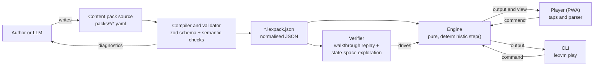

# LexVM

[](https://github.com/nullthrone/lexvm/actions/workflows/ci.yml)
[](https://github.com/nullthrone/lexvm/actions/workflows/pages.yml)
[](LICENSE)

LexVM is a player for text adventures that runs in the browser and works
offline. It is inspired by ScummVM: one deterministic **engine** runs many
games, and each game is a **content pack**, a file of declarative data with
no code in it. Content packs are written in YAML, compiled to JSON and
checked by tools that prove every game can be won and has no dead ends.
Because a content pack is plain data with a closed vocabulary, a large
language model (LLM) can write one from the specification alone.

The **player** is built for phones in portrait mode and tablets in airplane
mode: you tap objects and pick verbs, and you can also type commands in
German or English.

**Play now: <https://nullthrone.github.io/lexvm/>**

## Play offline

The player is a progressive web app (PWA). Open it once while online; after
that it works without a network connection.

| Device | How to install |
|---|---|
| iPhone, iPad | Open the link in Safari, tap **Share**, then **Add to Home Screen**. Start it once from the home screen while online. |
| Android | Open the link in Chrome, open the menu and tap **Install app** (or **Add to Home screen**). |
| Desktop (Chrome, Edge) | Click the install icon in the address bar. |

Alternatively, download the **single-file offline version**, one HTML file
that contains the player and the bundled content packs:

- <https://nullthrone.github.io/lexvm/lexvm-offline.html> (current build), or
- the `lexvm-offline.html` asset of a [GitHub Release](https://github.com/nullthrone/lexvm/releases).

Save the file and open it in any current browser, for example from a laptop
or a USB stick. It makes no network requests. Its saves are stored separately
from the installed app. On iPhone and iPad, prefer the home-screen install:
Safari only keeps storage of installed web apps reliably.

## Features

- **Tap-first play.** Objects in the text are tappable; an action sheet
  offers the verbs that make sense for that object (SCUMM-inspired). Exits
  and dialogue choices are buttons.
- **Optional text parser** for German and English (`nimm den Schlüssel`,
  `use key with door`).
- **Forgiving by design.** No losing endings and no dead ends, verified
  automatically for every content pack.
- **Progressive hints**, revealed one step at a time.
- **Saves and undo.** A save stores the game state and the command log, so
  it survives content pack updates.
- **Book typography** with serif type and sepia, light and dark themes.
- **Offline and private.** No accounts, no tracking, no network access at
  runtime. Saves stay on your device.
- **Bring your own adventure.** Import a content pack (`.yaml` or
  `.lexpack.json`) into the player.

## Create your own adventure

A content pack is a directory of YAML files that follows the
[content pack specification](docs/spec/content-pack.md). You can write one by
hand, or let an LLM write it:

1. **Prompt kit, any LLM, no API key.** In the player, open the prompt kit,
   copy the prompt into the LLM chat of your choice, describe your idea, then
   paste the result back into the player. The player validates it and, if
   needed, gives you a repair prompt with the exact problems to paste back.
   The same prompts are in [`prompts/`](prompts/) (for example
   [`prompts/oneshot.md`](prompts/oneshot.md)).
2. **CLI with the Anthropic API.** `lexvm generate` runs a staged generation
   with an automatic validate and repair loop. It needs an API key in
   `ANTHROPIC_API_KEY`.

Either way, check the result before you share it:

```sh
npm run lexvm -- check packs/my-pack
```

Details: [authoring guide](docs/authoring/guide.md) and
[generation pipeline](docs/authoring/pipeline.md).

## Developer quickstart

Requirements: Node.js 22 (see [`.nvmrc`](.nvmrc)) and npm.

```sh
git clone https://github.com/nullthrone/lexvm.git
cd lexvm
npm ci
npm run dev                                  # player with hot reload
npm test                                     # unit tests (Vitest)
npm run check:packs                          # verify all content packs
npm run lexvm -- play packs/locked-study     # play the demo in the terminal
```

| Script | Purpose |
|---|---|
| `npm run dev` | Compile the content packs, then start the Vite dev server for the player. |
| `npm run build` | Production build of the player into `apps/web/dist` (PWA and `lexvm-offline.html`). |
| `npm test` | Unit tests. |
| `npm run e2e -w @lexvm/web` | End-to-end tests with Playwright (run `npx playwright install chromium` once). |
| `npm run lint` / `npm run format` | Biome lint and format. |
| `npm run typecheck` | TypeScript checks for all workspaces. |
| `npm run check:packs` | `lexvm check` for every content pack in `packs/`. |
| `npm run prompts` | Regenerate the prompt kit in `prompts/`. |
| `npm run lexvm -- <command>` | Run the CLI from source. |

CLI commands (`npm run lexvm -- <command> --help` for options):

| Command | Purpose |
|---|---|
| `validate` | Schema and semantic checks. |
| `build` | Compile content packs to `.lexpack.json`. |
| `check` | `validate` plus walkthrough replay and state-space exploration. |
| `play` | Play a content pack in the terminal. |
| `new` | Scaffold a new content pack. |
| `schema` | Write the JSON Schema of the content pack format. |
| `prompt` | Assemble the prompt kit. |
| `generate` | Generate a content pack with the Anthropic API. |

## Repository layout

```
apps/web/          Player: PWA, vanilla TypeScript, Vite, hand-written service worker
packages/engine/   Engine: zod schema, compiler, runtime, parser, verifier (no DOM, no Node APIs)
packages/cli/      lexvm CLI
packs/             Content packs, one directory per pack (YAML sources)
prompts/           Prompt kit for LLMs (generated by `npm run prompts`, do not edit by hand)
schema/            JSON Schema generated from the zod schema
docs/              Specification, authoring guides, architecture, ADRs
.github/           CI, Pages deployment, releases, issue forms, labels and milestones as code
```

## Architecture



The engine is a pure function `step(pack, state, command)`: no clock, no
randomness, no I/O. Game state is plain JSON. The same commands always
produce the same game, which makes saves small (state plus command log),
bugs reproducible from a command log, and exhaustive verification possible.
See [docs/architecture.md](docs/architecture.md) and the
[architecture decision records](docs/adr/README.md).

## Status

LexVM is at **v0.1, in development**. The content pack format is
`lexvm-pack/1`; it may still change before v1.0, following the versioning
rules in the [specification](docs/spec/content-pack.md#16-versioning-of-this-format).

| Milestone | Scope |
|---|---|
| v0.1 Playable | Engine, tap-first PWA on GitHub Pages (offline), first German content pack, verifier, LLM pipeline |
| v0.2 Authoring & Polish | In-browser pack workshop, accessibility audit, parser coverage, save slots, more languages |
| v0.3 Community Pipeline | Pack proposals, automated generation PRs, pack catalog, review guidelines, provenance |
| v1.0 Stable Format | Frozen `lexvm-pack/1` with a compatibility promise, documentation site, security review |

Progress: [milestones](https://github.com/nullthrone/lexvm/milestones) and
[changelog](CHANGELOG.md).

## Deployment

Every push to `main` builds the player and deploys it to GitHub Pages
([`.github/workflows/pages.yml`](.github/workflows/pages.yml)). Pushing a tag
`v*` creates a GitHub Release with `lexvm-offline.html`, the compiled content
packs and a `SHA256SUMS.txt` attached
([`.github/workflows/release.yml`](.github/workflows/release.yml)).

One-time repository settings for maintainers:

- **Settings → Pages → Build and deployment → Source = GitHub Actions**, so
  the Pages workflow can deploy.
- **Settings → Code security → Private vulnerability reporting = enabled**,
  which [SECURITY.md](SECURITY.md) relies on.

## Contributing

Contributions are welcome: play and report bugs, write content packs, work on
the engine, the player or the docs, or translate. Start with
[CONTRIBUTING.md](CONTRIBUTING.md). This project follows the
[Code of Conduct](CODE_OF_CONDUCT.md). Report security issues privately as
described in [SECURITY.md](SECURITY.md).

## License

The code is licensed under the [MIT License](LICENSE).
Each content pack declares its own content license (an SPDX identifier in
`pack.yaml`). The demo pack `locked-study` is
[CC0-1.0](https://creativecommons.org/publicdomain/zero/1.0/). See
[packs/README.md](packs/README.md).
