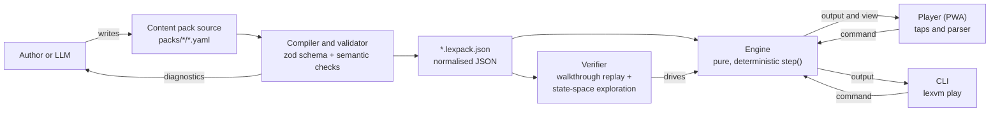

<div align="center">

# 🕯️ LexVM

### Text adventures for your pocket · Textabenteuer für die Hosentasche

A ScummVM-inspired engine for text adventures.<br/>
Plays offline on your phone. Written by humans or LLMs, **proven winnable** by machines.

**[▶️ Play now](https://nullthrone.github.io/lexvm/)** · [📥 Offline version](https://nullthrone.github.io/lexvm/lexvm-offline.html) · [📝 Create your own](#-create-your-own-adventure) · [☕ Support](https://ko-fi.com/tsprock)

[](https://github.com/nullthrone/lexvm/actions/workflows/ci.yml)
[](https://github.com/nullthrone/lexvm/actions/workflows/pages.yml)
[](LICENSE)
[](https://ko-fi.com/tsprock)

</div>

## 🎮 What is LexVM?

LexVM is a player for text adventures that runs in the browser and works
offline. Like ScummVM, one deterministic **engine** runs many games. Each game
is a **content pack**: a file of declarative data with no code in it, written
in YAML, compiled to JSON and verified by tools that prove it can be won and
has no dead ends. Because a content pack is plain data with a closed
vocabulary, a large language model (LLM) can write one from the specification
alone.

The **player** is built for phones in portrait mode and tablets in airplane
mode: tap objects, pick verbs, follow the story. If you prefer the classic
way, type commands in German or English.

## 🗺️ Now playing

| | Adventure | Language | Length | |
|---|---|---|---|---|
| 🕵️ | **Die letzte Nacht der Reichsmark**<br/>*Ein Hamburger Kriminalfall, Juni 1948.* The night before the currency reform, a dock worker vanishes, accused of stealing cigarettes. Clues, interrogations and a city full of hoarded goods. | 🇩🇪 Deutsch | ~45 min | Noir |
| 🔑 | **The Locked Study**<br/>*A five-minute LexVM demo.* Your uncle has vanished and his study is locked. | 🇬🇧 English | ~5 min | Demo |

Want more? [Write your own](#-create-your-own-adventure) or
[propose one](https://github.com/nullthrone/lexvm/issues/new?template=content_pack_proposal.yml).

## 📱 Play offline

The player is a progressive web app (PWA). Open it once while online; after
that it works without a network connection, airplane mode included.

| Device | How to install |
|---|---|
| 🍎 iPhone, iPad | Open the link in Safari, tap **Share**, then **Add to Home Screen**. Start it once from the home screen while online. |
| 🤖 Android | Open the link in Chrome, open the menu and tap **Install app** (or **Add to Home screen**). |
| 💻 Desktop (Chrome, Edge) | Click the install icon in the address bar. |

📥 Or download the **single-file offline version**: one HTML file that contains
the player and all bundled adventures.

- <https://nullthrone.github.io/lexvm/lexvm-offline.html> (current build), or
- the `lexvm-offline.html` asset of a [GitHub Release](https://github.com/nullthrone/lexvm/releases).

Open it in any current browser, from a laptop or a USB stick. It makes no
network requests. Its saves are stored separately from the installed app. On
iPhone and iPad, prefer the home-screen install: Safari only keeps storage of
installed web apps reliably.

## ✨ Features

- 👆 **Tap-first play.** Objects in the text are tappable; an action sheet
  offers the verbs that make sense (SCUMM-inspired). Exits and dialogue
  choices are buttons in the thumb zone.
- ⌨️ **Optional text parser** for German and English (`nimm den Schlüssel`,
  `use key with door`).
- 🛟 **Forgiving by design.** No losing endings, no dead ends: verified
  automatically for every adventure.
- 💡 **Progressive hints**, from a gentle nudge to the solution, one step at a
  time.
- 💾 **Autosave and undo.** A save is the game state plus the command log, so
  it survives updates to an adventure.
- 📖 **Book typography** with serif type and sepia, light and dark themes.
- 🔒 **Offline and private.** No accounts, no tracking, no network access at
  runtime. Saves stay on your device.
- 🧩 **Bring your own adventure.** Import a content pack (`.yaml` or
  `.lexpack.json`) straight into the player.

## 🧪 Proven winnable

Every adventure has to pass `lexvm check` before it ships:

1. 📐 **Schema and semantics:** every id, exit, flag and text reference
   resolves.
2. 🎬 **Walkthrough replay:** the included solution is played from the first
   command to a winning ending.
3. 🔭 **State-space exploration:** every reachable game state is searched to
   prove that you can always still win, using only what the app offers to tap.
4. ⏱️ **Play-time estimate:** word counts, reading speed and decision time give
   an expected length, checked against the adventure's target.

This is what makes LLM-written adventures trustworthy: a model can make up a
story, but it cannot talk its way past the verifier.

## 📝 Create your own adventure

A content pack is a directory of YAML files that follows the
[content pack specification](docs/spec/content-pack.md). Write one by hand, or
let an LLM write it:

1. 💬 **Prompt kit, any LLM, no API key.** In the player, open *Create your
   own*, copy the prompt into the LLM chat of your choice, describe your idea,
   then import the result into the player. The player validates it and shows
   the exact problems to paste back into the chat. The prompt is also in
   [`prompts/oneshot.md`](prompts/oneshot.md).
2. 🤖 **CLI with the Anthropic API.** `lexvm generate` runs a staged
   generation (concept → puzzle chart → world → logic) with an automatic
   validate-and-repair loop. It needs an API key in `ANTHROPIC_API_KEY`.

Either way, check the result before you share it:

```sh
npm run lexvm -- check packs/my-pack
```

📚 Details: [authoring guide](docs/authoring/guide.md) and
[generation pipeline](docs/authoring/pipeline.md).

## 🛠️ Developer quickstart

Requirements: Node.js 22 (see [`.nvmrc`](.nvmrc)) and npm.

```sh
git clone https://github.com/nullthrone/lexvm.git
cd lexvm
npm ci
npm run dev                                  # player with hot reload
npm test                                     # unit tests (Vitest)
npm run check:packs                          # verify all content packs
npm run lexvm -- play packs/locked-study     # play the demo in the terminal
```

| Script | Purpose |
|---|---|
| `npm run dev` | Compile the content packs, then start the Vite dev server for the player. |
| `npm run build` | Production build of the player into `apps/web/dist` (PWA and `lexvm-offline.html`). |
| `npm test` | Unit tests. |
| `npm run e2e` | End-to-end tests with Playwright on phone viewports (run `npx playwright install chromium` once). |
| `npm run lint` / `npm run format` | Biome lint and format. |
| `npm run typecheck` | TypeScript checks for all workspaces. |
| `npm run check:packs` | `lexvm check` for every content pack in `packs/`. |
| `npm run prompts` | Regenerate `prompts/oneshot.md` from the templates, spec and guide. |
| `npm run lexvm -- <command>` | Run the CLI from source. |

CLI commands (`npm run lexvm -- <command> --help` for options):

| Command | Purpose |
|---|---|
| `validate` | Schema and semantic checks. |
| `build` | Compile content packs to `.lexpack.json` and a catalog. |
| `check` | `validate` plus walkthrough replay, state-space exploration and play-time estimate. |
| `play` | Play a content pack in the terminal. |
| `new` | Scaffold a new content pack. |
| `schema` | Write the JSON Schema of the content pack format. |
| `prompt` | Assemble the prompt kit. |
| `generate` | Generate a content pack with the Anthropic API. |

## 🧭 Repository layout

```
apps/web/          Player: PWA, vanilla TypeScript, Vite, hand-written service worker
packages/engine/   Engine: zod schema, compiler, runtime, parser, verifier (no DOM, no Node APIs)
packages/cli/      lexvm CLI
packs/             Content packs, one directory per pack (YAML sources, design notes)
prompts/           Prompt kit for LLMs (templates/ is the source; oneshot.md is generated)
schema/            JSON Schema generated from the zod schema
docs/              Specification, authoring guides, architecture, ADRs
.github/           CI, Pages deployment, releases, issue forms, labels and milestones as code
```

## 🏗️ Architecture



The engine is a pure function `step(pack, state, command)`: no clock, no
randomness, no I/O. Game state is plain JSON. The same commands always
produce the same game, which makes saves small (state plus command log),
bugs reproducible from a command log, and exhaustive verification possible.
See [docs/architecture.md](docs/architecture.md) and the
[architecture decision records](docs/adr/README.md).

## 🚦 Status

LexVM is at **v0.1, in development**. The content pack format is
`lexvm-pack/1`; it may still change before v1.0, following the versioning
rules in the [specification](docs/spec/content-pack.md#16-versioning-of-this-format).

| | Milestone | Scope |
|---|---|---|
| 🟢 | v0.1 Playable | Engine, tap-first PWA on GitHub Pages (offline), first German adventure, verifier, LLM pipeline |
| 🟡 | v0.2 Authoring & Polish | In-browser pack workshop, auto-map, accessibility audit, parser coverage, save slots |
| ⚪ | v0.3 Community Pipeline | Pack proposals that become generation PRs, automated LLM playtests, pack catalog, provenance |
| ⚪ | v1.0 Stable Format | Frozen `lexvm-pack/1` with a compatibility promise, documentation site, security review |

Progress: [milestones](https://github.com/nullthrone/lexvm/milestones) and
[changelog](CHANGELOG.md).

## 🚀 Deployment

Every push to `main` builds the player and deploys it to GitHub Pages
([`.github/workflows/pages.yml`](.github/workflows/pages.yml)). Pushing a tag
`v*` creates a GitHub Release with `lexvm-offline.html`, the compiled content
packs and a `SHA256SUMS.txt` attached
([`.github/workflows/release.yml`](.github/workflows/release.yml)).

One-time repository settings for maintainers:

- **Settings → Pages → Build and deployment → Source = GitHub Actions**, so
  the Pages workflow can deploy.
- **Settings → Code security → Private vulnerability reporting = enabled**,
  which [SECURITY.md](SECURITY.md) relies on.

## 🤝 Contributing

Contributions are welcome: play and report bugs, write adventures, work on the
engine, the player or the docs, or translate. Start with
[CONTRIBUTING.md](CONTRIBUTING.md). This project follows the
[Code of Conduct](CODE_OF_CONDUCT.md). Report security issues privately as
described in [SECURITY.md](SECURITY.md).

## ☕ Support

LexVM is free and stays free. If you enjoy it, you can buy the maintainer a
coffee on [Ko-fi](https://ko-fi.com/tsprock).

## 📜 License

The code is licensed under the [MIT License](LICENSE).
Each content pack declares its own content license (an SPDX identifier in
`pack.yaml`). The demo pack `locked-study` is
[CC0-1.0](https://creativecommons.org/publicdomain/zero/1.0/); *Die letzte
Nacht der Reichsmark* is
[CC-BY-4.0](https://creativecommons.org/licenses/by/4.0/). See
[packs/README.md](packs/README.md).
