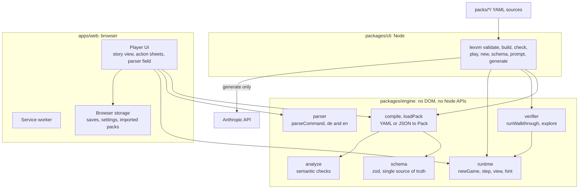
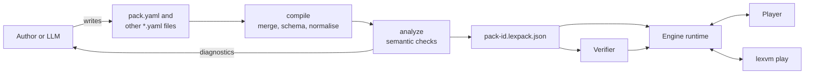
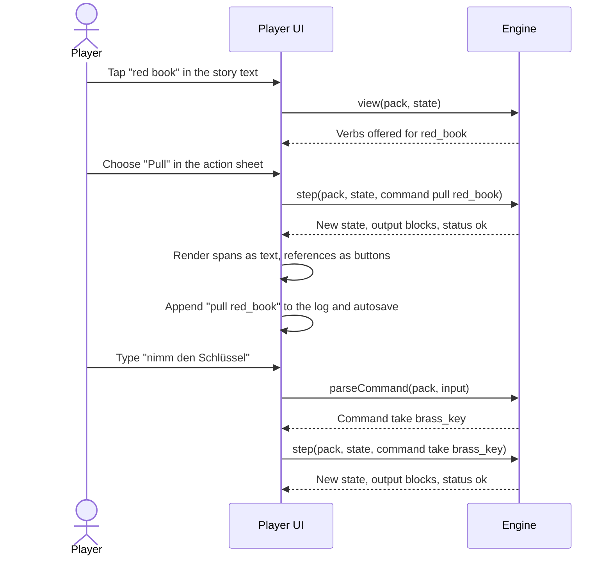
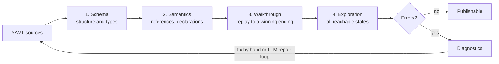
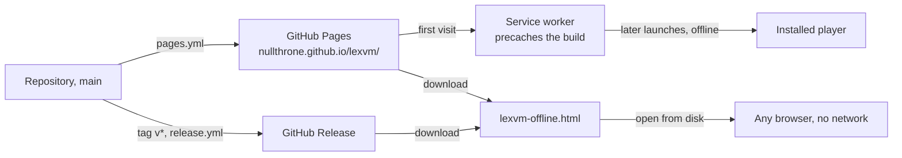

# Architecture

This document describes how LexVM is put together and the invariants that
hold it together. The reasons behind the major choices are recorded in the
[architecture decision records](adr/README.md). The content pack format itself
is defined in the [specification](spec/content-pack.md).

Contents:

1. [Goals](#1-goals)
2. [Components](#2-components)
3. [Data flow](#3-data-flow)
4. [A turn](#4-a-turn)
5. [Determinism model](#5-determinism-model)
6. [Verification pipeline](#6-verification-pipeline)
7. [Offline model](#7-offline-model)
8. [Security model](#8-security-model)
9. [Extension points](#9-extension-points)

## 1. Goals

- Play text adventures on phones and tablets, offline, with taps first and
  typing optional.
- Keep games as data that people and LLMs can write, and that tools can
  validate and verify completely.
- Make every game reproducible from its command log.
- Ship as static files: no server, no accounts, no tracking.

## 2. Components



| Component | Location | Responsibility |
|---|---|---|
| Content pack sources | `packs/<pack-id>/` | YAML files, one directory per pack. See [packs/README.md](../packs/README.md). |
| Schema | `packages/engine/src/schema.ts` | The zod schema of `lexvm-pack/1`. The JSON Schema in `schema/` is generated from it. |
| Compiler and validator | `packages/engine` (`compile`, `loadPack`, `analyze`) | Merge YAML files, parse them against the schema, normalise to one canonical `Pack`, run semantic checks, report diagnostics. |
| Runtime | `packages/engine` (`newGame`, `step`, `view`, `hint`) | Execute commands. Pure and deterministic. |
| Parser | `packages/engine` (`parseCommand`) | Turn typed German or English input into the same structured `Command` that taps produce. |
| Verifier | `packages/engine` (`runWalkthrough`, `explore`) | Replay the walkthrough; explore the reachable state space. |
| CLI | `packages/cli` | Authoring tools: `validate`, `build`, `check`, `play`, `new`, `schema`, `prompt`, `generate`. |
| Player | `apps/web` | The PWA: library, story view, action sheets, parser field, hints, saves, themes, prompt kit, pack import. |
| Prompt kit | `prompts/` | Prompts for LLMs, generated from the specification, the authoring guide and the demo pack by `npm run prompts`. |

**Dependency rules.**

- The engine depends only on `yaml` and `zod`. It uses no DOM and no Node
  APIs, so it runs unchanged in the browser, in Node and in workers.
- The CLI and the player depend on the engine, never the other way round.
  The CLI and the player do not depend on each other.
- The player uses no UI framework ([ADR 0009](adr/0009-vanilla-typescript-ui.md)).

## 3. Data flow



1. Authors (people or LLMs) write YAML. The compiler reads `pack.yaml`
   first, then the other files of the directory in name order, and merges
   them by top-level key.
2. The merged document is parsed against the zod schema. Parsing normalises
   the lenient input forms (a single condition instead of a list, a single
   effect instead of a list), so the resulting `Pack` always has one
   canonical shape.
3. Semantic checks resolve every reference and report diagnostics.
4. `lexvm build` writes the normalised pack as `<pack-id>.lexpack.json`. The
   build of the player bundles the compiled packs from `packs/`.
5. The player can also import `.yaml` and `.lexpack.json` files at runtime;
   they pass through the same compiler and checks.

Every diagnostic has a `severity`, a stable `code`, a `path` into the pack, a
`message` that explains how to fix the problem, and the source `file` and
`line` when known. Messages are written so that both people and LLMs in a
repair loop can act on them.

## 4. A turn

Taps and typed commands produce the same structured `Command`
(`{ verb, object?, with? }`). Everything after that is shared.



- `view(pack, state)` returns the affordances: present objects with the verbs
  their action sheets offer, the inventory and clues, exits, dialogue options,
  score and ending. The player renders only what `view` returns, so the UI
  never offers an action the engine would not understand.
- `step` returns `status: "rejected"` with an explanation for invalid commands
  (object not present, exit not listed, game over). The state is unchanged
  and the command is not logged.
- Output is a list of blocks (`text`, `npc`, `player`, `system`,
  `room-title`, `echo`, `ending`), each a list of spans. A span with `ref` is
  a reference to an object and is rendered as a tappable button.
- Meta commands (`undo`, `restart`, `hint`, `save`, `load`, ...) are handled
  by the host, not by the engine's state machine.

## 5. Determinism model

The engine is a pure function:

```
step(pack, state, command) -> { state, output, status }
```

**Invariants.**

- No clocks, no randomness, no I/O, no environment-dependent behaviour (for
  example no locale-sensitive string functions in the parser).
- Inputs are never mutated; every call returns a new state.
- `GameState` is plain JSON: no `Map`, `Set`, class instances or `undefined`
  values. It can be saved, hashed, compared and sent anywhere.
- Iteration order is pack order. Rules fire in list order; maps such as
  `rooms` and `objects` keep source order. JavaScript preserves insertion
  order for string keys that are not array indices, and ids always start with
  a letter.

**State.** `GameState` holds the current room, the location and
open/locked/hidden state of every object, flags, counters, visited rooms,
spent `once` rules and dialogue options, the active dialogue, score, the
ending, and a turn counter. `stateKey(state)` is a canonical key of the
*logical* state; it excludes the turn counter, so two ways of reaching the
same situation are the same state.

**Saves.** A save (`lexvm-save/1`) contains:

| Field | Purpose |
|---|---|
| `pack` | id, version and content hash (`packHash`) of the pack it belongs to |
| `state` | the `GameState` |
| `log` | every accepted command since the start, as canonical strings (`use brass_key study_door`) |
| `savedAt` | timestamp set by the host (the engine never reads the clock) |

When a save is loaded and the pack hash matches, the state is restored
directly. When the pack has changed, the player replays the log against the
new version; if a command is rejected, replay stops at the last valid state
and the player is told.

**Consequences.**

- Undo is cheap: the host keeps earlier states, or replays the log minus the
  last command.
- A bug report with a command log reproduces the exact game on any device.
- Walkthroughs, tests and save logs share one canonical command syntax.
- Exhaustive verification is possible because states can be deduplicated.

## 6. Verification pipeline



`lexvm check` runs four stages, as defined in
[section 14 of the specification](spec/content-pack.md#14-walkthrough-and-verification):

1. **Schema.** zod validation of structure and types.
2. **Semantics.** Every referenced id exists, flags and counters are
   declared, doors are openable, custom exits have labels, `once` rules have
   ids, text references point to objects, dialogue targets exist, endings are
   wins. Also warnings such as rules shadowed by earlier, more general rules
   and texts that are too long for a phone screen.
3. **Walkthrough.** The pack's `walkthrough` is replayed from a new game;
   every command must be accepted and the last one must reach a winning
   ending.
4. **Exploration.** A breadth-first search over all reachable logical states,
   deduplicated by `stateKey`, trying every action `view` offers except
   `drop`. It proves that a winning ending is reachable from every reachable
   state (no dead ends) and that no losing ending is reachable, and it reports
   content that is never reached. The search stops at a state limit (200,000
   by default) and then reports an incomplete result as a warning. Counters
   changed by `turn` rules must be bounded, or the state space is infinite.

Where verification runs:

| Where | What |
|---|---|
| `lexvm check`, `npm run check:packs` | All four stages. |
| CI ([`ci.yml`](../.github/workflows/ci.yml)) | `npm run check:packs` on every push and pull request. |
| `lexvm generate` | All stages after every generation step; diagnostics drive the repair loop. |
| Player, on import | Schema and semantics before a pack is loaded. The verifier is part of the engine, so the player can run it too. |

The policy behind this is described in
[ADR 0005](adr/0005-forgiving-policy-verified-by-exploration.md).

## 7. Offline model



`npm run build` produces two deliverables in `apps/web/dist`:

1. **The PWA**, built with Vite for the base path `/lexvm/`, with a web app
   manifest, a hand-written service worker and the compiled content packs in
   `dist/packs/`.
2. **`lexvm-offline.html`**, a single HTML file with all scripts, styles and
   the bundled content packs inlined. It works from `file://`, where service
   workers are not available, and makes no network requests.

Service worker behaviour:

- **Install:** precache the app shell and the bundled packs of this build
  under a cache name that is versioned per build.
- **Fetch:** answer same-origin `GET` requests for precached files from the
  cache; the player needs nothing else.
- **Update:** a new build installs in the background and takes over on the
  next launch; old caches are deleted on activation. A running game is never
  swapped out from under the player.

Saves, settings and imported packs are stored in browser storage on the
device and never leave it. On iOS, Safari may evict storage of websites that
have not been used for a while; installed home-screen apps are exempt, which
is why the README recommends **Add to Home Screen**.

GitHub Pages hosting and the reasons for the hand-written service worker are
described in [ADR 0006](adr/0006-offline-first-pwa-on-github-pages.md).

## 8. Security model

Content packs, save files and parser input are untrusted. The full threat
model is in [SECURITY.md](../SECURITY.md). Rules for code in this repository:

- **Validate at the boundary.** A pack reaches the runtime only as a `Pack`
  that passed the schema and semantic checks. Saves are validated before they
  are restored.
- **Data, never code.** Nothing from a pack or save is evaluated, imported or
  used as a property path into engine internals.
- **Text, never HTML.** Output spans are inserted with `textContent` or text
  nodes. `innerHTML` and similar sinks are not used with pack or save data.
- **Own properties only.** Ids such as `constructor` and `toString` are valid,
  so lookups use `Object.hasOwn`, `Map`, or objects without a prototype.
- **No network at runtime.** The engine performs no I/O. The player requests
  only its own same-origin files. Only `lexvm generate` in the CLI talks to a
  network service (the Anthropic API), with a key from the environment.
- **Bounded work.** Exploration has a state limit; the player keeps
  verification off the UI thread or bounded.

## 9. Extension points

| Extension | How | Format change? |
|---|---|---|
| New verbs for a pack | Pack verbs in `verbs` with labels, synonyms and a default text; behaviour through rules. | No |
| New conditions or effects | Schema, specification, runtime, verifier, prompt kit. | Yes: ADR, see [CONTRIBUTING.md](../CONTRIBUTING.md#changing-the-content-pack-format) |
| New content language | Engine messages and parser vocabulary for the language; accept it in `language`. | Additive |
| New UI language | UI strings in `apps/web`. | No |
| Themes | CSS custom properties in the player. | No |
| Pack sources | Bundled packs today, import of files and pasted text; a pack catalog is planned for v0.3. | No |
| Generation pipeline | Prompt kit stages and `lexvm generate` stages build on the specification and diagnostics; see the [generation pipeline](authoring/pipeline.md). | No |
| Other front ends | Anything that can call `newGame`, `view`, `step` and `parseCommand` can host LexVM, for example a terminal (`lexvm play`), a screen-reader-first interface or a chat bot. | No |
