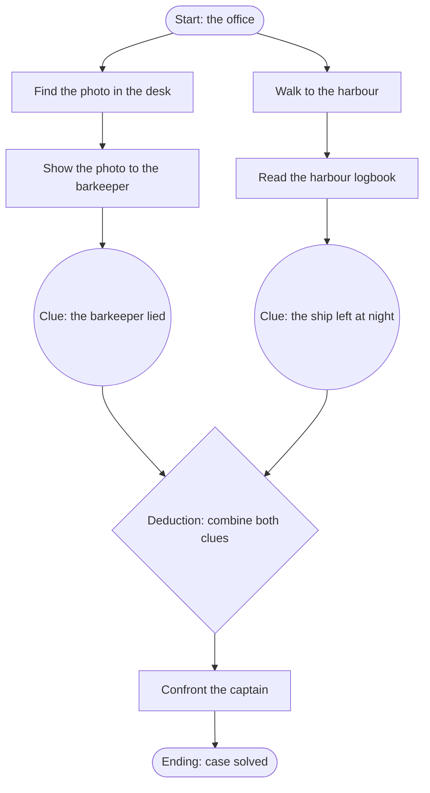

# Authoring guide: designing a good LexVM adventure

This guide is for everyone who writes LexVM content packs: people writing by
hand, people prompting a chat LLM, and the `lexvm generate` pipeline. The pack
*format* is specified in [content-pack.md](../spec/content-pack.md); this guide
is about making the game *good*: fair, solvable, and pleasant to play on a
phone. How to generate packs with an LLM is described in
[pipeline.md](pipeline.md).

> **Maintainers:** the parts between `<!-- prompt:begin … -->` and
> `<!-- prompt:end … -->` markers are embedded into the LLM prompts by
> `lexvm prompt` and `lexvm generate` (`guide` regions as the condensed guide,
> the `checklist` region as the self-check list). Keep them terse, imperative
> and self-contained; put explanations for humans outside the markers. After
> editing, run `npm run prompts` to regenerate `prompts/oneshot.md` (a test
> fails while it is out of date).

LexVM players mostly tap: they tap an object, pick a verb from its action
sheet, and for two-object verbs ("use … with …", "show … to …") pick a second
object. A text parser exists but is optional. That has consequences for design:
the player can *see* every possible action, so puzzles cannot rely on obscure
verbs, and every tap should be answered with something worth reading.

## 1. Shape and pacing

A LexVM game is short and dense: it is played in a few sittings on a phone,
often offline. The first pack targets 30–45 minutes.

<!-- prompt:begin guide -->
## Shape and pacing
- A 30–45 minute game has about 10–12 rooms, 6–8 puzzles, 3–5 characters and 8–15 clues or key items. Scale proportionally for other lengths (15 minutes: ~5 rooms, 3–4 puzzles).
- The intro states a clear goal; the first small success comes within the first few minutes.
- Structure the game in 2–3 chapters separated by bottlenecks (a key event everything converges on). Within a chapter several puzzles are open at once.
- End with a climax that uses what the player learned (a confrontation, a deduction), then a winning ending.
- Score is a progress signal: usually 1 point per solved puzzle, 2 for a major deduction. Award each point exactly once (guard with a flag, a `not: { has: … }` condition or a `once` rule). `maxScore` equals the total score collected by the walkthrough.
<!-- prompt:end guide -->

## 2. Puzzle dependency charts

Ron Gilbert's *puzzle dependency chart* is the tool for designing adventure
puzzles. Start at the end — the winning ending — and ask: what has to be true
right before it? And what before that? Each answer is a node; an arrow means
"is needed for". The result is a graph that shows at a glance whether the game
is a boring corridor (a single chain) or an open space where the player always
has something else to try when stuck.

A small example for a detective story. Two independent branches (the bar and
the harbour) run in parallel and meet in a deduction, which unlocks the
confrontation:



When you draw the chart, check three things: every leaf can be reached from
the start, every node has a concrete solution in game commands, and there is
no long stretch where only one node is open.

<!-- prompt:begin guide -->
## Puzzle dependency chart
- Design the puzzles as a dependency chart (Ron Gilbert): start from the winning ending and work backwards — what must be true right before it, and what before that. Nodes are puzzles, events, items and clues; an arrow means "is needed for".
- The chart must branch: at nearly every point the player has 2–3 open puzzles in parallel. Never build one long linear chain.
- Every node has a concrete solution in canonical commands, a place in the text where it is signposted, and a hint.
- Every item or clue a puzzle needs is obtainable before that puzzle and can never be lost afterwards.
- Example (Mermaid):
  ```mermaid
  flowchart TD
    intro([Start]) --> photo[Find photo in desk]
    intro --> harbour[Go to harbour]
    photo --> lie((Clue: barkeeper lied))
    harbour --> night((Clue: ship left at night))
    lie --> deduce{use clue_lie clue_night}
    night --> deduce
    deduce --> confront[Confront captain] --> win([Ending])
  ```
<!-- prompt:end guide -->

## 3. The LucasArts rules: the `forgiving` policy

LexVM follows the design philosophy that Ron Gilbert summarised in *Why
Adventure Games Suck* and that LucasArts games made famous: the player should
never be punished for exploring. In LexVM this is not a style recommendation
but a verified property: `lexvm check` explores every reachable state of the
game and fails the pack if any ending is not a win, or if any reachable state
can no longer lead to a win.

<!-- prompt:begin guide -->
## The LucasArts rules (forgiving policy)
- No deaths and no losing endings: every ending has `win: true`. Danger is a narrow escape ("You step back just in time.") that leaves the game state as it was.
- No dead ends: from every reachable state the game stays winnable. Never consume, destroy or give away an item that is still needed; if an action uses an item up, record the result permanently (a flag) instead of needing the item again. Never lock the player out of a room they still need.
- Essential information must stay obtainable. Dialogue options with `once: true` are fine when the option `learn`s the clue (clues are permanent); otherwise keep a repeatable way to get the information.
- No "guess the verb": solutions use the core verbs (look, take, open, close, use, talk, give, show, push, pull, go) or a pack verb that the object lists in its `verbs`, so it appears in the action sheet.
- No pixel hunting: every object the player can interact with is visibly mentioned. Hidden objects are revealed with a clear message (`say` + `reveal`).
- No timed puzzles, no mazes, no randomness (the engine has none).
<!-- prompt:end guide -->

## 4. Fair clueing

A puzzle is fair when an attentive player could solve it from what the game
has shown them. The test: could you write the hint for it by quoting the
game's own text?

<!-- prompt:begin guide -->
## Fair clueing
- Signpost every puzzle in the text before the player must solve it: describe the obstacle, and hint at the solution through an observation, a character's remark or a document. Important solutions get two independent hints.
- Answer plausible wrong attempts with specific rules that teach something: `use rusty_key cellar_door` → "The key is far too small for this lock." Reserve the engine's default "That doesn't work." for implausible ideas.
- Examine texts carry the clues: an object description says what is odd or useful about the object.
- Reflect state changes with text variants (`when`) in room and object descriptions (the door now stands open, the drawer is empty).
<!-- prompt:end guide -->

## 5. Rules and state

Rules are the heart of a pack. Read section 10 of the spec ("Turn processing")
once carefully; most logic bugs come from forgetting that rules *replace* the
default behaviour and that only the *first* matching command rule fires.

<!-- prompt:begin guide -->
## Rules and state
- Rules replace defaults: a rule for `take x` must `move` x to `inventory` itself if the player should get it.
- Only the first matching command rule whose `when` holds fires. Put specific rules before general ones; add a second rule for the "already done" response (see `pull_red_book` / `pull_red_book_again` in the example).
- Remember progress in flags; guard one-time effects (score, reveal, learn) with `when: { not: { flag: … } }` or `once: true` plus an `id`.
- Doors: an openable, non-container object with `locked: true` and `unlockedBy: key_id`; the default `use key_id door_id` unlocks it, `open door_id` opens it; both exits name the door.
- Containers: `container: true`, `openable: true`, `open: false`; contents are only present while open.
- Counters changed by `turn` rules must be bounded by their `when`. Prefer flags over counters.
<!-- prompt:end guide -->

## 6. Characters and dialogue

Dialogue-heavy games (interrogations, negotiations) live from the feeling that
conversations *progress* as the player learns more. In LexVM that is done with
options that appear when the player holds a clue.

<!-- prompt:begin guide -->
## Characters and dialogue
- Hub and spoke: a dialogue starts at a hub node (e.g. `hello`) that offers topics; each topic node leads back to the hub ("I see." → `goto: hello`). The hub always has a way out: an option without `goto` ("Goodbye.").
- Interrogations progress by knowledge: options with `when: { has: clue_x }` appear once the player knows something. `once: true` hides an option after use.
- Confrontations: let the player show evidence — a rule `on: { verb: show, object: clue_x, with: npc_id }` — or offer a dialogue option gated by `has: clue_x`. Give characters a reaction to every clue that plausibly concerns them, and one generic reaction (`on: { verb: show, with: npc_id }`) placed after the specific rules.
- Characters remember: change greetings and descriptions with flags after key events.
- Node `say` ≤ 300 characters, option text ≤ 80. Options are the player's words; narration belongs in `say` or `do`.
<!-- prompt:end guide -->

## 7. Clues, deductions and the notebook

The notebook is LexVM's answer to "where do I keep what I learned?". Clues are
objects that live in the notebook part of the inventory. Because they are
objects, every verb works with them: the player can *use* two clues together to
deduce something, or *show* a clue to a character to confront them.

<!-- prompt:begin guide -->
## Clues and deductions
- A clue is a piece of knowledge: an object with `clue: true` and `location: nowhere`, acquired with the `learn` effect (reading a document, examining something, a dialogue). Clues sit in the notebook and cannot be dropped or lost.
- Clue names are short and telling (≤ 24 characters: "Torn ticket", "Alibi gap"); the description states the fact.
- Deductions combine two clues: a rule `on: { verb: use, object: clue_a, with: clue_b }` with `when: { not: { has: clue_c } }` that `learn`s the conclusion `clue_c` (rules are tried in both orders). Only ask for deductions a player can reasonably see; answer plausible wrong combinations gently.
- Interrogations and confrontations use clues as evidence (see dialogue).
<!-- prompt:end guide -->

## 8. Hints

Every LexVM game has a hint button. A good hint system means nobody has to
search the web for a walkthrough, and nobody gets the answer before they want
it.

<!-- prompt:begin guide -->
## Hints
- Every puzzle has a hint: `when` = the puzzle is known (room visited, clue held), `until` = the puzzle is solved (flag set, item held, room visited).
- 2–3 progressive steps: a nudge ("The butler seems to know more than he says."), a direction ("Ask him about last night."), the explicit solution ("Talk to Graves and ask where your uncle is.").
- The first hint whose `when` holds and whose `until` does not is shown, so order hints in the usual solving order, and make sure some hint applies at every point until the ending.
<!-- prompt:end guide -->

## 9. Text for phone screens

LexVM is read on a phone held in portrait mode, in a book-like layout. Long
paragraphs become walls of text; references (`{id}`) become tappable words.

<!-- prompt:begin guide -->
## Text for phone screens
- Budgets: room descriptions ≤ 600 characters, object descriptions ≤ 400, dialogue lines ≤ 300, option texts ≤ 80, names ≤ 24. Aim well below.
- Short paragraphs of 1–3 sentences. The first sentence says what matters; atmosphere second.
- Mention exits naturally in the room description ("The library lies to the west.").
- Every interactable object appears as `{id}` (or `{id|inflected text}`) in its room's description or in its own `roomText`. Portable objects without `roomText` are listed automatically.
- Names are short, without articles, and distinct: "brass key", not "the small brass key".
- Rule messages (`say`) are 1–2 sentences.
<!-- prompt:end guide -->

## 10. Language conventions

Ids are always ASCII `lower_snake_case`; English ids are fine for every pack
language and make diagnostics easier to read. Everything the player sees is in
the pack's `language`.

<!-- prompt:begin guide -->
## Language conventions
- All player-facing text is in the pack `language`. Ids are ASCII `lower_snake_case` (English ids are fine for any language).
- German (`de`): narrate in the du-form, present tense ("Du stehst im Kontor.") unless the pack deliberately decides otherwise — then stay consistent. Each character consistently says "Sie" or "du" to the player, as fits the setting. Object names without articles ("Logbuch", "Messingschlüssel"). Inflected references use `{id|text}`: `{logbook|des Logbuchs}`, `{door|die Tür}`. Quotes »…« or „…“ — choose one style and use it everywhere. Real umlauts and ß. Add inflected and short forms to `synonyms` (`[Logbuchs, Buch]`).
- English (`en`): second person, present tense ("You are in the hall."). Names lower case except proper nouns ("brass key", "Graves"). One quote style throughout.
- Pack verbs need a `label` in the pack language and parser `synonyms` (German: imperative and infinitive, e.g. `[lies, lese, lesen]`).
<!-- prompt:end guide -->

## 11. YAML pitfalls

YAML is friendly until it is not. Almost every pack that fails to load does so
because of one of the following.

<!-- prompt:begin guide -->
## YAML pitfalls
- Prefer block style. Use flow style (`{ … }`, `[ … ]`) only for short, simple values like `{ to: hall }`, `{ has: brass_key }`, `[pull]`.
- Inside a flow mapping, `, ` and `: ` end the value: `do: { say: Hello, world }` is broken. Write effects that contain text in block style:
  ```yaml
  do:
    - say: "Hello, world: nice to see you."
  ```
- Quote a string with double quotes if it contains `: ` or ` #`, ends with `:`, or starts with `"`, `'`, `{`, `[`, `*`, `&`, `!`, `|`, `>`, `%`, `@`, a backtick, `- `, `? ` or `: `. Inside double quotes escape `"` as `\"` (or use »…« / “…” quotes, which need no escaping). Inside single quotes write an apostrophe as `''`.
- Multi-paragraph text: a literal block `|-` with a blank line between paragraphs.
- `version: 1.0.0` (three numbers; `1.0` would be a number). Booleans are `true`/`false` only.
- Indent with two spaces, never tabs.
<!-- prompt:end guide -->

## 12. The walkthrough

The walkthrough is the pack's proof of solvability. `lexvm check` replays it
from a new game, so it has to be exact.

<!-- prompt:begin guide -->
## The walkthrough
- A list of canonical commands with ids — never display names or translated words: `take brass_key`, `go north`, `use brass_key study_door`, `give coin ferryman`, `show clue_ticket inspector`, `talk graves`, `choose ask_uncle`, `read letter` (pack verb).
- Two-object commands list both ids without a preposition: `use a b`, `give a b`, `show a b`.
- Replay it in your head from the start: be in the right room; open doors and containers before going through or taking from them; reveal hidden objects before taking them; inside a dialogue only `choose <option_id>` works, for an option available at that moment; leave the dialogue (an option without `goto`) before the next non-dialogue command.
- It ends with the command that triggers the winning ending, and collects every point (total = `maxScore`).
- Write it last, after all rooms, objects, rules and dialogues exist.
<!-- prompt:end guide -->

## 13. Checklist of common mistakes

Run through this list before you run `lexvm check` — and run `lexvm check`
anyway. The LLM prompts ask the model to go through the same list.

<!-- prompt:begin checklist -->
1. **Undeclared flags or counters.** Every flag used in `set`, `clear` or a `flag:` condition is declared under `flags:` with its initial value; every counter under `counters:`.
2. **Flow-mapping quoting.** No unquoted `: `, `, ` or ` #` inside `{ … }`; texts with punctuation are in block style or double-quoted.
3. **Missing reverse exits.** Exits are one-way: every exit has a way back in the destination room. A door is in both rooms (`location` + `alsoIn`) and both exits name it with `door:`.
4. **Walkthrough uses names instead of ids.** Every command is `verb id [id]` with exit, object and option ids — no display names, articles, prepositions or translated verbs.
5. **`once` rules without `id`.** Every rule with `once: true` has an `id` (better: every rule has one).
6. **Losing endings.** Every ending has `win: true`; no deaths, no failure endings.
7. **Dead ends.** No reachable state from which the game cannot be won: needed items cannot be used up, given away, locked away or lost; essential clues stay obtainable.
8. **Missing hints.** Every puzzle has a hint with `until` and 2–3 progressive steps; some hint applies at every stage until the ending.
9. **Texts too long for phones.** Room descriptions ≤ 600 characters, object descriptions ≤ 400, dialogue lines ≤ 300, option texts ≤ 80, names ≤ 24.
10. **Unreferenced scenery.** Every non-portable object (scenery, character, container, door) appears as `{id}` in its room's description or has a `roomText`; every `{id}` in a text names an existing object.
11. **Broken references.** Every id used in exits, `door`, `unlockedBy`, `dialogue`, `goto`, conditions and effects exists; characters with `dialogue:` have that dialogue; every dialogue node is reachable and every dialogue can be left.
12. **Invisible verbs.** Every pack verb is declared under `verbs:` and listed in the `verbs` of each object it applies to.
13. **One key per condition and effect.** `{ set: a, score: 1 }` is two effects; two conditions go in a list or `all: […]`.
14. **Score.** Each point is awarded once; `maxScore` equals the walkthrough's total.
<!-- prompt:end checklist -->

## 14. Reviewing a pack (human or generated)

`lexvm check` proves that a pack is *correct*. Whether it is *good* is up to
you. Before you publish, play it on a phone and ask:

- Is the goal clear after the intro? Is there an early success?
- When stuck, are there always other things to try (look at the chart)?
- Is every puzzle solvable from the text alone, without the hints?
- Do characters react to the evidence you show them?
- Is the text tight? Does it read well on a small screen, in the chosen
  narrative voice, with consistent quotes?
- Are there plausible actions that get a bland default answer where a custom
  response would be better?
- Does the ending pay off what the player found out?

LLM-generated packs in particular tend to be wordy, to over-use atmosphere
adjectives, and to forget custom responses for wrong attempts. A careful edit
pass is part of the job; see [pipeline.md](pipeline.md) for provenance and
licensing.
