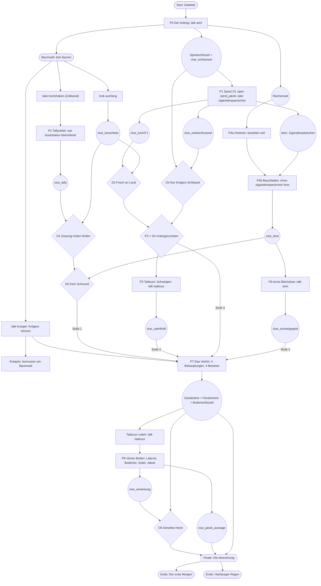

# Puzzles, walkthrough and state

Eight puzzles (P1–P8) and a finale. Every solution uses core verbs (`look`,
`take`, `open`, `close`, `use`, `talk`, `give`, `show`, `go`, `choose`) or the
pack verb `bezahlen`, which the objects it applies to list in `verbs`. Ids
match [world.md](world.md) and [cast.md](cast.md).

> **Playtest round 1.** This file describes the pack as it is after the
> first round of playtests. Quoted texts are the design wording; where the
> pack words a line differently, [CHANGES.md](CHANGES.md) says why. The
> main changes: documents are read with `look` (no pack verb `lesen`), the
> notebook mechanic is taught in the intro, paying works with `bezahlen`,
> single-answer dialogue steps are merged, and the Kontor opens only with
> all three finale proofs.

## Dependency chart

The chart passes the Mermaid validator.

**Shape.** After the short tutorial (P0) and the locker (P1), three strands
run in parallel:

- **A, paper trail:** boat hook → tally sheet → D1.
- **B, frame-up:** D2 + D3 → D4 → Tadeusz.
- **C, St. Pauli:** Reichsmark → backyard → Lene → Anni.

The strands cross: C needs the cigarette pack from P1, and D5 needs A and C.
Kröger's interrogation is the bottleneck where they meet. Each of his four
claims is refuted by a different strand. At almost every point in Act II,
2–4 puzzles are open. Act III is a short corridor on purpose: a change of
pace and a rescue. The finale uses only what the player has learned.

## Conventions and global rules

**Pack verbs**

| Verb | `label` | `synonyms` | `default` |
|---|---|---|---|
| `use` (override of the core verb) | Benutzen | `[angle, angel, angeln, fische, fisch, halte, halt]` | Das bringt dich nicht weiter. |
| `bezahlen` | Bezahlen | `[bezahle, bezahl, zahle, zahl, zahlen, kaufe, kauf, kaufen, bestich, besteche, bestechen, spendiere, spendier]` | Hier will keiner dein Geld. |
| `zaehlen` | Zählen | `[zähle, zähl, nachzählen]` | Du zählst, wie Jakob. Die Zahl bleibt dieselbe. |
| `horchen` | Horchen | `[horche, horch, lausche, lausch, lauschen]` | Nur der Regen. |
| `helfen` | Helfen | `[hilf, helfe, trage, trag, tragen, stütze, stütz, stützen]` | Allein schaffst du das nicht. |

The `use` default answers failed clue pairs in the notebook too; the
action sheet shows `use` on a clue as »Kombinieren mit …«, and the parser
maps »kombiniere«, »vergleiche« and »verbinde« to it. Objects with
`bezahlen`: `wirt`, `tresen`. `zaehlen`, `horchen` and `helfen` are for
typed commands only (no object lists them).

There is no reading verb: the parser maps »lies« to `look` when a pack has
no `read` verb. Documents show their text when examined (`bekanntmachung`,
`kreidetafel`, `wachbude` in their description; `aushang` and `zettel`
through the rules `look_aushang` and `look_zettel`, which also teach the
clue).

**Global rules**

- **`drop_im_regen`** (`on: { verb: drop }`): »Im Regen lässt man nichts
  liegen. Nicht in Hamburg, 1948.« No item can be lost. This keeps the
  forgiving guarantee for real players, although the explorer skips
  `drop`.
- **NPC reactions.** Per-NPC `show`/`give` catch-alls and the Reichsmark
  gags are listed in [cast.md](cast.md#reactions-outside-dialogues-command-rules).
  Specific rules come before the catch-alls.
- **Wrong attempts are text-only.** No wrong attempt ever sets a flag or
  moves an object. The explorer tries text-only rules once per pack and adds
  no states for them.
- **No `once` rules, no `once` options, no `turn` rules, no `visited`
  conditions.**

### State-changing rules

All other rules are text-only. Specific rules for an object come before
general ones. The two "in the dark" rules come before the two door-opening
rules.

| Rule id | Trigger (`on`) | `when` | Effects |
|---|---|---|---|
| `talk_anni_auftrag` | `talk anni` | `not: { flag: auftrag_angenommen }` | `dialogue: anni_auftrag` |
| `asmussen_hinterhalt` | `event: enter, room: baumwall` | `has: clue_kroeger_version`; `not: { flag: asmussen_getroffen }` | `move asmussen → baumwall`; `set asmussen_getroffen`; `dialogue: asmussen_warnung` |
| `look_aushang` | `look aushang` | – | `say` (Löschliste text, see world.md); `learn clue_loeschliste` |
| `open_spind` | `open spind_jakob` | `isLocked: spind_jakob`; `has: spindschluessel` | `unlock spind_jakob`; `open spind_jakob`; `move spindschluessel → nowhere`; `say`; `learn clue_zweitschluessel`; `score 1` |
| `use_schluessel_spind` | `use spindschluessel spind_jakob` | same as `open_spind` | same as `open_spind` |
| `take_paeckchen` | `take zigarettenpaeckchen` | `not: { has: zigarettenpaeckchen }` | `move zigarettenpaeckchen → inventory`; `say`; `learn clue_los4471` |
| `d1_zwanzig_kisten` … `d6_dieselbe_hand` | `use clue_a clue_b` | `not: { has: result }` | `say`; `learn result`; `score` (see world.md, deductions) |
| `d1_zwanzig_kisten_heft` | `use clue_tally clue_zaehlheft` | `not: { has: clue_zwanzig_kisten }` | as D1 |
| `d2_frisch_an_land_paeckchen` | `use zigarettenpaeckchen clue_loeschliste` | `not: { has: clue_frisch_an_land }` | as D2 |
| `d6_dieselbe_hand_zettel` | `use zettel clue_persilschein` | `not: { has: clue_dieselbe_hand }` | `say`; `learn clue_anweisung`; `learn clue_dieselbe_hand`; `score 2` |
| `take_bootshaken` | `take bootshaken` | `not: { has: bootshaken }` | `move bootshaken → inventory`; `say` |
| `angeln_klemmbrett` | `use bootshaken klemmbrett` | `not: { has: clue_tally }` | `say`; `move bootshaken → nowhere`; `learn clue_tally`; `score 1` |
| `angeln_glaskabine` | `use bootshaken glaskabine` | `not: { has: clue_tally }` | same as `angeln_klemmbrett` |
| `take_klemmbrett_haken` | `take klemmbrett` | `has: bootshaken` (after `take_klemmbrett_fertig`) | same as `angeln_klemmbrett` |
| `give_reichsmark_wirt` | `give reichsmark wirt` | `not: { flag: hintertuer_frei }` | `say`; `move reichsmark → nowhere`; `set hintertuer_frei`; `score 1` |
| `bezahlen_wirt`, `bezahlen_tresen`, `bezahlen_hoftuer` | `bezahlen wirt` / `tresen` / `hoftuer` | `not: { flag: hintertuer_frei }` | same as `give_reichsmark_wirt` |
| `bezahlen_reichsmark` | `bezahlen reichsmark` | `at: kneipe`; `not: { flag: hintertuer_frei }` | same as `give_reichsmark_wirt` |
| `open_hoftuer_frei` | `open hoftuer` | `flag: hintertuer_frei` | `say`; `goto: hinterhof` |
| `show_paeckchen_lene` | `show zigarettenpaeckchen lene` | `not: { has: clue_lene }` | `say` (the `l_redet` line); `say` (the `l_kuvert` line); `learn clue_lene`; `score 1` |
| `show_los_lene` | `show clue_los4471 lene` | `not: { has: clue_lene }` | same as `show_paeckchen_lene` |
| `show_untergeschoben_tadeusz` | `show clue_untergeschoben tadeusz` | `not: { has: clue_zaehlheft }` | `say`; `dialogue: tadeusz_gespraech` |
| `show_frisch_tadeusz`, `show_nur_kroeger_tadeusz` | `show clue_frisch_an_land` / `clue_nur_kroeger tadeusz` | `not: { has: clue_zaehlheft }` | with `clue_untergeschoben`: as above; otherwise `say` only (»Ein halber Beweis …«) |
| `show_lene_anni` | `show clue_lene anni` | `not: { has: clue_schweigegeld }` | `say`; `dialogue: anni_huette` |
| `laterne_anzuenden` | `use streichhoelzer sturmlaterne` | `not: { flag: laterne_an }` | `say`; `set laterne_an`; `move sturmlaterne → inventory` |
| `laterne_anzuenden_kurz` | `use sturmlaterne` (any second object) | `not: { flag: laterne_an }`; `has: streichhoelzer` | same as `laterne_anzuenden` |
| `bodentuer_dunkel` | `open bodentuer` | `not: { flag: laterne_an }` | `say` only |
| `bodentuer_dunkel_use` | `use bodenschluessel bodentuer` | `not: { flag: laterne_an }` | `say` only |
| `bodentuer_auf` | `open bodentuer` | `flag: laterne_an`; `isLocked: bodentuer`; `has: bodenschluessel` | `unlock bodentuer`; `open bodentuer`; `say`; `score 1` |
| `bodentuer_auf_use` | `use bodenschluessel bodentuer` | `flag: laterne_an`; `isLocked: bodentuer` | same as `bodentuer_auf` |
| `open_kontortuer_frei` | `open kontortuer` | `has: clue_jakob_aussage`; `has: clue_dieselbe_hand` | `say`; `goto: kontor` |
| `look_zettel` | `look zettel` | – | `say` (note text); `learn clue_anweisung` |
| `take_zettel` | `take zettel` | – | `say` »Du lässt ihn liegen; wer immer den Fall bekommt, soll ihn hier finden. Aber du schreibst ihn ab, Wort für Wort.«; `learn clue_anweisung` |

## Puzzles

### P0: Der Auftrag (tutorial, `detektei`)

- **Goal:** take the case.
- **Prerequisites:** none.
- **Solution:** a linear dialogue that cannot be left half-way:
  `talk anni`, `choose an_frag_jakob`, `choose an_frag_schluessel`,
  `choose an_annehmen`. Anni tells the police part without being asked,
  and the dialogue ends with her leaving.
- **Teaches the notebook:** after the key, Voss's habit from the insurance
  days: »Ein einzelner Eintrag im Notizbuch beweist nichts. Erst wenn du
  zwei kombinierst, die zusammenpassen, wird ein Schluss daraus.« The
  locker (P1) then points at the first pair (D3).
  - **Yields:** `clue_auftrag`, `clue_schluessel`, `spindschluessel`,
    `reichsmark`, `auftrag_angenommen`.
  - **Side effect:** Anni moves to `nissenhuette`.
- **Signposting:** the intro ends on the woman in your visitor's chair, and
  her `roomText` names her.
- **Wrong attempts:**

| Command | Response |
|---|---|
| `go down` before the dialogue | Anni Brodersen sitzt noch auf deinem Besucherstuhl. Erst hörst du ihr zu. (exit `blocked`) |
| `look regeneimer` | Ein Emailleeimer, halb voll. Der Regen tropft durch die Decke, im Takt einer Uhr, die niemand aufzieht. |

- **Hint `h_auftrag`:**
  1. Die Frau auf deinem Besucherstuhl ist deine Klientin.
  2. Sprich mit Anni Brodersen.
  3. Sprich mit Anni und hör ihr bis zum Ende zu.

### P1: Spind 23 (`kaischuppen`)

- **Goal:** open Jakob's locker and find what the police missed.
- **Prerequisites:** `spindschluessel` (P0).
- **Solution:**
  1. `open spind_jakob` (rule `open_spind`), or `use spindschluessel
     spind_jakob`. The lock opens, the key stays in it, and you learn
     `clue_zweitschluessel`. 1 point.
     - `say`: »Der Schlüssel dreht sich schwer, dann gibt das Bartschloss nach. Du lässt den Schlüssel stecken. Innen an der Tür, schabloniert: ›Zweitschlüssel beim Vorarbeiter‹. Der Spind ist leer. Fast: Hinter der Rückwand klemmt ein {zigarettenpaeckchen}.«
     - then: »Ein zweiter Schlüssel, beim Vorarbeiter. Und Jakobs eigener hing zu Hause am Haken. Zwei Einträge in deinem Notizbuch, die zusammengehören.«
  2. `take zigarettenpaeckchen` (rule `take_paeckchen`). You learn
     `clue_los4471`.
     - `say`: »Du ziehst das Päckchen hinter der Rückwand hervor. Auf der Banderole: ›NAAFI – LOT 4471‹. Ein Los, ein Schiff – das weißt du noch aus der Versicherung.«
  3. `look aushang` (rule `look_aushang`; »lies den Aushang«) gives
     `clue_loeschliste`. It is independent of the locker and needed by D1
     and D2.
- **Signposting:**
  - Anni names locker 23 and gives you the key.
  - The `spindreihe` has a chalked »23« and »DIEB«.
  - The Aushang hangs at the door in the room text.
- **Wrong attempts:**

| Command | Response |
|---|---|
| `pull spind_jakob` | Festgeschraubt. Und laut wäre es auch. |
| `close spind_jakob` | Du lässt ihn offen. Jakob hat nichts zu verbergen. (keeps the locker one-way) |
| `use spindschluessel glaskabine` | Zu klein. Der gehört zu einem Spind, nicht zu einem Glaskasten. |
| `take spindreihe` | Zwanzig Blechspinde. Du hast zwei Hände. |

- **Hint `h_aushang`:**
  1. Im Kaischuppen hängt etwas am Tor.
  2. Der Aushang verrät, was Donnerstagnacht gelöscht wurde.
  3. Lies den Aushang im Kaischuppen.
- **Hint `h_spind`:**
  1. Anni hat dir Jakobs Spindschlüssel gegeben.
  2. Kaischuppen 17 liegt südlich vom Baumwall. Such dort Spind 23.
  3. Geh nach Süden in den Kaischuppen und öffne Spind 23.
- **Hint `h_paeckchen`:**
  1. Die Polizei hat zwei Stangen gefunden. Hat sie alles gefunden?
  2. Sieh dir den offenen Spind genau an.
  3. Nimm das Zigarettenpäckchen aus Spind 23.

### P2: Der Tallyzettel (`zollkanal` → `kaischuppen`)

- **Goal:** read what Kröger counted.
- **Prerequisites:** none. This strand is independent of the locker.
- **Solution:**
  1. `take bootshaken` at the Zollkanal (rule `take_bootshaken`).
     - `say`: »›Nehmen Sie‹, sagt Tadeusz, ohne aufzusehen. ›Er gehört mir sowieso nicht.‹«
  2. In the Kaischuppen, `use bootshaken klemmbrett` (rule
     `angeln_klemmbrett`; `use bootshaken glaskabine`, `take klemmbrett`
     while holding the hook and »angle …« work too). The hook falls into
     the locked cabin and you learn `clue_tally`. 1 point.
     - `say`: »Du schiebst den Bootshaken durch den Spalt und angelst nach dem Nagel. Beim dritten Mal kommt das Klemmbrett mit: ›Elspeth Gray, Do. Nachtschicht: 180 Kisten. W. Kröger, i. V. Tallymann.‹ / Du hängst es zurück. Dabei rutscht dir der Haken aus der Hand und poltert in die Kabine. Er gehörte Tadeusz ja sowieso nicht.«
  3. `use clue_tally clue_loeschliste` → **D1** `clue_zwanzig_kisten`.
     1 point. `use clue_tally clue_zaehlheft` (Jakob's count) gives the
     same deduction.
- **Signposting:**
  - `look klemmbrett`: »… Dein Arm reicht nicht bis dorthin. Du bräuchtest etwas Langes mit einem Haken.«
  - `look schuten`: »Fast an jeder lehnt ein Bootshaken. An der Wachbude lehnt einer, der niemandem zu gehören scheint.«
  - The boat hook's `roomText` is in the Zollkanal.
- **Wrong attempts:**

| Command | Response |
|---|---|
| `open glaskabine` | Abgeschlossen. Der Schuppenmeister ist bis Montag bei seiner Schwester in Harburg. |
| `push glaskabine` | Glas einschlagen, im Hafen, am Sonnabend? Dann steht morgen dein Name in der Zeitung, nicht Krögers. |
| `take klemmbrett` without the hook | Dein Arm reicht nicht bis an den Nagel. Du bräuchtest etwas Langes mit einem Haken. |
| `use streichhoelzer klemmbrett` | Beweise verbrennt man nicht. Das machen andere. |
| `use clue_tally clue_los4471` | Auf dem Tallyzettel steht keine Losnummer. Aber irgendwo anders vielleicht. |

- **Hint `h_tally`:**
  1. Im Kaischuppen hängt hinter Glas, was Kröger gezählt hat.
  2. Durch den Spalt über der Glaskabine reicht dein Arm nicht. Am Zollkanal liegen Boote – und was man an Booten so braucht.
  3. Nimm den Bootshaken am Zollkanal und benutze ihn im Kaischuppen mit dem Klemmbrett.
- **Hint `h_zwanzig`:**
  1. Zweihundert laut Löschliste. Und laut Kröger?
  2. Leg die beiden Zahlen nebeneinander. Beide stehen in deinem Notizbuch.
  3. Im Notizbuch: Kombiniere »Tallyzettel (180 Kisten)« mit »Löschliste (200 Kisten)«.

### P3: Untergeschoben (notebook)

- **Goal:** prove the frame-up.
- **Prerequisites:** P1 and `clue_loeschliste`.
- **Solution:**
  1. `use clue_schluessel clue_zweitschluessel` → **D3** `clue_nur_kroeger`.
     1 point. The locker's text points at this pair.
  2. `use clue_los4471 clue_loeschliste` → **D2** `clue_frisch_an_land`.
     1 point. `use zigarettenpaeckchen clue_loeschliste` works too.
  3. `use clue_frisch_an_land clue_nur_kroeger` → **D4**
     `clue_untergeschoben`. 2 points.
- **Signposting:**
  - Anni's own question in the intro: »Wer hat einen Schlüssel zu dem Spind?«
  - The stencil »Zweitschlüssel beim Vorarbeiter«.
  - Voss's insurance knowledge on taking the pack: »Ein Los, ein Schiff.«
  - Kröger's interrogation teaches the logic: each half alone is rebutted
    in `k_s3`.
- **Wrong attempts** (text-only rules; see also near misses in world.md):

| Command | Response |
|---|---|
| `use clue_auftrag clue_zweitschluessel` | Ein Zweitschlüssel beim Vorarbeiter. Und wo war Jakobs eigener Schlüssel? |
| `use clue_nur_kroeger clue_auftrag` | Seit Donnerstagmittag konnte nur Kröger an den Spind. Aber vorher Jakob. Wann kam die Ware an Land? |
| `use clue_frisch_an_land clue_auftrag` | Die Ware kam Donnerstagnacht. Jakob war Donnerstagnacht an Bord. Hatte er seinen Schlüssel dabei? |

- **Hint `h_nur_kroeger`:**
  1. Wer konnte Spind 23 seit Donnerstag öffnen?
  2. Jakobs Schlüssel hing zu Hause. Und der zweite? Zwei Einträge im Notizbuch gehören zusammen.
  3. Im Notizbuch: Kombiniere »Der vergessene Schlüssel« mit »Zweitschlüssel«.
- **Hint `h_frisch`:**
  1. Losnummern verraten das Schiff. Wann kam dieses Los an Land?
  2. Vergleiche das Los mit der Löschliste.
  3. Im Notizbuch: Kombiniere »Los 4471« mit »Löschliste (200 Kisten)«.
- **Hint `h_untergeschoben`:**
  1. Du weißt jetzt, wann die Ware an Land kam und wer seitdem an den Spind konnte.
  2. Zusammen beweisen die beiden Schlüsse etwas über Jakob.
  3. Im Notizbuch: Kombiniere »Frisch an Land« mit »Nur Krögers Schlüssel«.

  The third steps name the entries with »Im Notizbuch:« in front, so the
  rest can be typed as it stands.

### P4: St. Pauli – Hintertür und Bauchladen (`kneipe`, `hinterhof`)

- **Goal:** get past the landlord and make Lene name her supplier.
- **Prerequisites:**
  - P4a needs `reichsmark` (P0).
  - P4b needs `zigarettenpaeckchen` (P1).
- **Solution:**
  1. **P4a:** `bezahlen wirt` (»bezahl den Wirt«, »kauf ein Bier«; rules
     `bezahlen_*`) or `give reichsmark wirt` (rule `give_reichsmark_wirt`)
     sets `hintertuer_frei`. The Reichsmark is gone. 1 point.
     - `say`: »Der Wirt wiegt das Bündel in der Hand, statt zu zählen. ›Zweihundert, schätz ich. Damit zahl ich der Brauerei meine Schulden, in Altpapier, und die müssen’s nehmen.‹ Er nickt zur Hintertür. ›Geh’n Se ruhig durch.‹«
  2. `go hintertuer` (or `open hoftuer`).
  3. **P4b:** `show zigarettenpaeckchen lene` (rule `show_paeckchen_lene`).
     `show clue_los4471 lene`, or `talk lene` and `choose l_los`, gives the
     same result. You learn `clue_lene`. 1 point.
  4. `use clue_zwanzig_kisten clue_lene` → **D5** `clue_kein_schwund`.
     1 point.
- **Signposting:**
  - `look kreidetafel`: »… ›Reichsmark nur noch bis Sonntag!‹ …«
  - The Wirt and the Tresen offer »Bezahlen« in the action sheet.
  - `talk wirt`: »… Heut nehm ich sogar noch Reichsmark. Die Brauerei will bis Sonntag ihr Geld.«
  - Everyone else refuses the Reichsmark with a joke: a running gag that
    pays off exactly once.
  - The blocked exit names the condition: »Da hinten nur Kundschaft, die
    zahlt.«
  - Lene's lie (»Ich rauch nicht mal.«) is contradicted by `look
    bauchladen`: »… ›NAAFI – LOT 44…‹«.
- **Wrong attempts:**

| Command | Response |
|---|---|
| `go hintertuer` before P4a | Der Wirt stellt sich vor die Tür. »Da hinten nur Kundschaft, die zahlt.« |
| `give zigarettenpaeckchen wirt` | »Stecken Se das weg. Hier vorne wird nur Bier verkauft.« |
| `bezahlen lene` | »Womit denn? Deine Reichsmark hat der Wirt.« Lene mustert dich. »Zeig mir lieber, was du in der Tasche hast.« |
| `show reichsmark wirt` | »Zeigen nützt nix. Hergeben.« |
| `give zigarettenpaeckchen lene` | »Ein Päckchen? Dafür kriegst du zwei Feuersteine. Und keine Antwort.« (you keep it) |
| `show clue_tally lene` | »Zahlen interessieren mich nur, wenn Geld davorsteht.« |
| `take bauchladen` | Lene legt die Hand darauf. »Gucken kostet nix. Anfassen schon.« |
| `use clue_zwanzig_kisten clue_zaehlheft` | Jakob kam auf dieselbe Rechnung wie du, zwanzig zu wenig. Aber dem Heft eines Verschwundenen glaubt keiner. Wer verdient an den zwanzig Kisten? |

- **Hint `h_hintertuer`:**
  1. Hinter der Kneipe wird gehandelt. Der Wirt lässt nur zahlende Kundschaft durch.
  2. Lies die Kreidetafel. Wer will heute noch Reichsmark?
  3. Bezahl den Wirt.
- **Hint `h_lene`:**
  1. Lene sagt, sie raucht nicht. Ihr Bauchladen sagt etwas anderes.
  2. Zeig ihr, was du aus Jakobs Spind hast.
  3. Zeig Lene das Zigarettenpäckchen.
- **Hint `h_kein_schwund`:**
  1. Kröger sagt: Was fehlt, ist Schwund.
  2. Zwanzig Kisten fehlen – und Lene hat genau dieses Los bei Kröger gekauft.
  3. Im Notizbuch: Kombiniere »Zwanzig Kisten fehlen« mit »Lenes Aussage«.

### P5: Tadeusz' Schweigen (`zollkanal`)

- **Goal:** get Jakob's counting notebook and Tadeusz's testimony.
- **Prerequisites:** `clue_untergeschoben` (P3).
- **Solution:** `talk tadeusz` (or `show clue_untergeschoben tadeusz`, which
  opens the same conversation), then:
  1. `choose t_kein_dieb` → node `t_heft` learns `clue_zaehlheft`.
     1 point.
  2. `choose t_wohin`.
  3. `choose t_angst`. His answer ends the conversation.
- Showing only one half of the frame-up proof (`clue_frisch_an_land` or
  `clue_nur_kroeger`) gets »Ein halber Beweis, Voss. Für Ihre Polizei ist
  ein halber Beweis ein ganzer Dieb.«
- **Signposting:**
  - Anni: »Fragen Sie Tadeusz am Zollkanal.«
  - Tadeusz (`t_jakob`): »Wenn Jakob ein Dieb ist, bin ich der Freund eines Diebes. Wenn nicht … dann ist das etwas anderes.«
  - The register in the `wachbude` is »nicht für Fremde« until he trusts
    you.
- **Wrong attempts:**

| Command | Response |
|---|---|
| `show zigarettenpaeckchen tadeusz` | »Das haben mir die Polizisten am Freitag auch gezeigt. Mit der Frage, wo ich den Rest versteckt habe.« |
| `look wachbude` before P5 | … Als du hineinsehen willst, legt Tadeusz die Hand darauf. »Das ist nicht für Fremde.« |
| `give reichsmark tadeusz` | »Ich habe genug Geld gesehen, das nichts wert ist.« |
| `show clue_auftrag tadeusz` | Tadeusz sieht hin und wieder weg. »Ich habe gelernt, nichts zu sehen.« (catch-all) |

- **Hint `h_tadeusz`:**
  1. Anni hat einen Freund von Jakob erwähnt.
  2. Tadeusz am Zollkanal redet erst, wenn er sicher ist, dass Jakob kein Dieb ist.
  3. Sprich am Zollkanal mit Tadeusz: »Jakob ist kein Dieb. Ich kann es beweisen.«

### P6: Annis Blechdose (`nissenhuette`)

- **Goal:** get the truth about the envelope.
- **Prerequisites:** `clue_lene` (P4b).
- **Solution:** `talk anni` (or `show clue_lene anni`), then:
  1. `choose ah_kuvert` → node `ah_kuvert` learns `clue_schweigegeld`.
     1 point.
  2. `choose ah_warum`. Her answer ends the conversation.
- **Signposting:**
  - Lene: »Am Abend is er bei den Brodersens rein. Mit ’nem Kuvert.«
  - `look blechdose`: Anni sits between you and the shelf.
  - `show clue_untergeschoben anni`: »Ihr Blick geht zur Blechdose.«
- **Wrong attempts:**

| Command | Response |
|---|---|
| `open blechdose` | Anni stellt sich vor das Bord. »Das ist meins, Voss.« |
| `take blechdose` | Anni stellt sich vor das Bord. »Das ist meins, Voss.« |
| `give reichsmark anni` | Sie schiebt es zurück. »Das gehört jetzt Ihnen. So wertlos, wie es ist.« |
| `talk lotte` | Du lässt sie schlafen. |

- **Hint `h_anni`:**
  1. Lene hat Kröger mit einem Kuvert bei den Brodersens gesehen.
  2. Davon hat Anni dir nichts erzählt. Frag sie in ihrer Hütte.
  3. Fahr mit der Straßenbahn zur Siedlung und frag Anni nach Krögers Kuvert.

### P7: Das Verhör (`kneipe`)

- **Goal:** make Kröger confess.
- **Prerequisites:**
  - The first talk is open from the start of Act II. It records the four
    claims in `clue_kroeger_version` and triggers Asmussen's ambush on your
    next entry to the Baumwall.
  - Each stage needs the result of one strand:

| Stage | Kröger claims | Valid evidence | Strand |
|---|---|---|---|
| 1 | Schwund | `clue_kein_schwund` (D5) | A + C |
| 2 | Mitternacht Schluss | `clue_zaehlheft` (P5) | B |
| 3 | Dieb bleibt Dieb | `clue_untergeschoben` (D4) | B |
| 4 | Nichts mit den Brodersens | `clue_schweigegeld` (P6) | C |

- **Solution:** `talk kroeger`, `choose k_verhoer1`, `choose
  k_s1_kein_schwund`, `choose k_s2_heft`, `choose k_s3_untergeschoben`,
  `choose k_s4_kuvert`, `choose k_g_wo` (place, key, Persilschein and the
  way across in one answer), then `choose k_g_zeuge` (or `choose
  k_g_richter`).
  - **Progress:** counter `kroeger_stufe` 0 → 4. Stages 1–3 are worth
    1 point each; the confession is worth 2.
  - **Yields:** `clue_gestaendnis`, `clue_persilschein`, `bodenschluessel`
    and optionally `kroeger_zeuge`.
  - You can leave after any stage and come back. The hub then offers the
    next stage (»Weiter …«).
- **Signposting:**
  - `clue_kroeger_version` lists the four claims in order.
  - Wrong evidence gets a rebuttal that names what is missing. For example,
    in stage 3, »Und vorher hatte er seinen.« → you need the timing as well.
  - While a stage's proof is missing, Voss's thought after the rebuttal
    points the way: in stage 1 to combining notebook entries (»Die Antwort
    steht schon in deinem Notizbuch, verteilt auf zwei Einträge.«, or, with
    one half missing, to the other half's source), in stage 2 to Jakob's
    Heft, in stage 4 to Anni. Entering stage 1 with nothing in hand says
    so.
- **Wrong attempts:** the rebuttals in [cast.md](cast.md#kroeger_verhoer-the-interrogation-p7).
  Outside the dialogue:

| Command | Response |
|---|---|
| `show <anything> kroeger` | Kröger sieht nicht hin. »Wenn Se was wollen, reden Se mit mir.« |
| `give reichsmark kroeger` | »Reichsmark? Ab morgen tapezier ich damit.« |

- **Forced event (the ambush).** Rule `asmussen_hinterhalt` fires on the
  first entry to `baumwall` after the first talk with Kröger. It runs a
  linear dialogue: `choose a_w_wer`, `choose a_w_ablehnen`. You learn
  `clue_asmussen`; Asmussen moves to `kontor`. The `kneipe` connects only to
  `baumwall` and `hinterhof`, so the ambush always happens before Act III.
- **Hint `h_kroeger_version`:**
  1. Jakobs Vorarbeiter heißt Kröger. Er trinkt in St. Pauli.
  2. Westlich vom Baumwall liegt die Kneipe »Zum Letzten Groschen«.
  3. Geh in die Kneipe und sprich mit Kröger.
- **Hint `h_verhoer`:**
  1. Kröger hat vier Behauptungen, und jede widerlegt genau ein Beweis. Lies »Krögers Version« im Notizbuch.
  2. Schwund → »Kein Schwund«. Mitternacht → »Jakobs Zählheft«. Dieb → »Untergeschoben«. Brodersens → »Zweihundert Reichsmark«.
  3. Sprich mit Kröger, wähle »Reden wir über Donnerstagnacht« und leg die Beweise in dieser Reihenfolge vor.

### P8: Vierter Boden (`zollkanal` → Speicher K)

- **Goal:** cross the customs border, find Jakob and Asmussen's written order.
- **Prerequisites:** `clue_gestaendnis` and `bodenschluessel` (P7).
- **Solution:**
  1. `talk tadeusz`, `choose t_ueberfahrt`. This sets `tadeusz_rudert`, and
     the exit `ueberfahrt` appears.
  2. `go ueberfahrt`, `go up`.
  3. `use streichhoelzer sturmlaterne` (rule `laterne_anzuenden`; »zünde
     die Laterne an«). This sets `laterne_an` and puts the lantern into
     the inventory.
     - `say`: »Der Docht fängt beim zweiten Streichholz. Du hebst die Laterne an. Gelbes Licht auf schwarzen Stufen.«
  4. `open bodentuer` (rule `bodentuer_auf`; `use bodenschluessel bodentuer`
     works too). 1 point.
     - `say`: »Der Schlüssel passt, natürlich. Das Schloss ist geölt, die Tür schwingt lautlos nach innen auf.«
  5. `go up`.
  6. `look zettel` (»lies den Zettel«; or `take zettel`) gives
     `clue_anweisung`.
  7. `talk jakob`, `choose j_was`, `choose j_durchhalten`. You learn
     `clue_jakob_aussage`. 1 point.
  8. `use clue_anweisung clue_persilschein` → **D6** `clue_dieselbe_hand`.
     2 points. `use zettel clue_persilschein` on the fourth floor works
     too and copies the note on the way.
- **Signposting:**
  - `look zollgitter`: »… Hinüber nur mit Hafenausweis. Oder übers Wasser.«
  - Kröger (`k_wo`): »Ich nehm jeden Abend das Boot vom Wächter am Zollkanal.«
  - The dark stairwell description; the lantern's `roomText`; your starting
    matches.
  - The persilschein and the order are described with the same three
    features (green ink, upright script, looped »g«).
  - The fountain pen in the Kontor (»Du hast diese Tinte heute schon
    gesehen.«).
  - Asmussen's rebuttal »Ohne Unterschrift?« in `f_s2`.
- **Wrong attempts:**

| Command | Response |
|---|---|
| `open bodentuer` without light (`bodentuer_dunkel`) | Im Dunkeln findest du das Schlüsselloch nicht. Auf dem Absatz stand doch eine Laterne. |
| `use bodenschluessel bodentuer` without light | Im Dunkeln findest du das Schlüsselloch nicht. Auf dem Absatz stand doch eine Laterne. |
| `go up` with the door shut | Die Bodentür ist zu. (exit `blocked`) |
| `close bodentuer` | Du lässt sie offen. Hinter dieser Tür war lange genug zu. |
| `go down` to the Kontor before Jakob | Unter der Kontortür liegt ein Lichtstreifen. Asmussen kann warten. Erst Jakob. (exit `blocked`) |
| `go down` / `open kontortuer` after Jakob, without D6 | Du legst die Hand auf die Klinke und zögerst. Asmussen wird alles abstreiten. … (points to the Zettel, then to the notebook) |
| `open kontortuer` before Jakob | Asmussen kann warten. Erst Jakob. |
| `use streichhoelzer sturmlaterne` again | Sie brennt schon. |
| `use streichhoelzer kisten` / `kaffeesaecke` | Feuer in einem Speicher? Hamburg hat genug gebrannt. |
| `take kisten` | Zwanzig Kisten. Du hast zwei Hände. |
| `take jakob` | Mit dem Bein? Nicht ohne Trage. Und nicht ohne Arzt. |
| `open zollgitter`, `use … zollgitter` | Die Kette ist dicker als dein Handgelenk. |
| `use clue_anweisung clue_asmussen` | Asmussens Karte ist gedruckt. Du brauchst etwas, das er mit der Hand geschrieben hat. |

- **Hint `h_ueberfahrt`:**
  1. Jakob ist in Speicher K. Die Zollbrücke ist nachts zu.
  2. Kröger hat gesagt, wessen Boot er nimmt.
  3. Sprich am Zollkanal mit Tadeusz: »Jakob lebt. Speicher K, vierter Boden.«
- **Hint `h_laterne`:**
  1. Im Treppenhaus ist es fast dunkel.
  2. Auf dem Absatz steht eine Sturmlaterne. Du hast Streichhölzer.
  3. Zünde die Sturmlaterne mit den Streichhölzern an.
- **Hint `h_bodentuer`:**
  1. Kröger hat dir einen Schlüssel gegeben.
  2. Mit Licht findest du auch das Schloss.
  3. Öffne die Bodentür und geh hinauf.
- **Hint `h_jakob`:**
  1. Der Mann am Pfeiler ist Jakob.
  2. Er ist wach. Sprich mit ihm.
  3. Sprich mit Jakob und frag, was passiert ist.
- **Hint `h_anweisung`:**
  1. Unter der Wasserkanne klemmt Papier.
  2. Kröger hat seine Anweisung hier liegen lassen.
  3. Lies den Zettel.
- **Hint `h_hand`:**
  1. Grüne Tinte. Wo hast du die schon einmal gesehen?
  2. Vergleiche die Anweisung mit Krögers Persilschein.
  3. Im Notizbuch: Kombiniere »Die Anweisung« mit »Krögers Persilschein«.

### Finale: Die Abrechnung (`kontor`)

- **Goal:** prove Asmussen's guilt, refuse his bribe, decide who gets the
  case.
- **Prerequisites:**
  - The office stairs (and `open kontortuer`) need `clue_jakob_aussage`
    and `clue_dieselbe_hand`, the proofs of rungs 3 and 2; rung 1's
    Persilschein comes with the confession. So the stateless ladder is
    never entered half-armed, and leaving it never costs progress.
- **Solution:** `go down`, `go down`, `talk asmussen`, `choose f_anklage`,
  `choose f_s1_persil`, `choose f_s2_hand`, `choose f_s3_arzt`,
  `choose f_ablehnen`, then `choose f_englaender` or `choose f_kripo`.
  - The final choice is worth 4 points and ends the game.
  - The ladder is stateless. Leaving restarts at rung 1, and no points are
    awarded before the final choice.
- **Signposting:** Asmussen states each claim. The wrong evidence
  rebuttals point to the right piece, for example »Ohne Unterschrift?«
  → D6. The pen on his desk does too.
- **Wrong attempts:** rebuttals in [cast.md](cast.md#asmussen_finale-the-reckoning-finale).
  Outside the dialogue:

| Command | Response |
|---|---|
| `show <anything> asmussen` | Asmussen sieht nicht einmal hin. »Ich kaufe nichts, Voss.« |
| `give reichsmark asmussen` | »Ich wechsle seit Wochen in die andere Richtung, Voss.« |
| `take kaffeetasse` | Asmussen hebt eine Augenbraue. Das reicht. |

- **Hint `h_finale`:**
  1. Asmussen hat für jede Behauptung eine Ausrede. Auf jede passt genau ein Beweis.
  2. »Kenne ich kaum« → Persilschein. »Hinter meinem Rücken« → Dieselbe Hand. »Leben gerettet« → Jakobs Aussage.
  3. Sprich mit Asmussen, leg Persilschein, Dieselbe Hand und Jakobs Aussage vor, lehn sein Angebot ab und entscheide.

## Endings

Both endings have `win: true`. Their `text` is a list of variants: the first
has `when: { flag: kroeger_zeuge }`, the second has no condition. The last
paragraph is identical everywhere.

### `ende_erster_morgen`: Der erste Morgen

Variant with `kroeger_zeuge`:

> Um halb sechs stehen zwei Jeeps der Militärpolizei am Kehrwieder. Ein Captain zählt die Kisten nach und schreibt ›Lot 4471 – complete‹. Asmussen steigt ohne Mantel in den Wagen. Vor einem britischen Gericht zählen seine Persilscheine nicht.
>
> Jakob tragen sie auf einer Tür zum Boot. »Zweihundert«, sagt er zu jedem, der fragt. Tadeusz rudert, dann sagt er aus. Weggesehen hat er lange genug. Kröger redet drei Stunden lang, ohne Köm. Er bekommt zwei Jahre.
>
> Sonntagmorgen. Anni und Lotte stehen in der Schlange vor der Kartenstelle. Anni legt drei Lebensmittelkarten auf den Tisch und hundertzwanzig Reichsmark: vierzig für jeden Kopf. Am Montag sind die Schaufenster voll, als hätte jemand sie über Nacht gefüllt. Hat ja auch jemand.

Default variant: the second paragraph becomes

> Jakob tragen sie auf einer Tür zum Boot. »Zweihundert«, sagt er zu jedem, der fragt. Tadeusz rudert, dann sagt er aus. Weggesehen hat er lange genug. Kröger ist am Morgen fort, nach Harburg, heißt es. Von da an kommt jeden Monat ein Kuvert ohne Absender nach Hütte 14.

### `ende_hamburger_regen`: Hamburger Regen

Variant with `kroeger_zeuge`:

> Kommissar Petersen kommt selbst, im nassen Mantel. Am Freitag hat er zugesehen, wie Kröger Jakobs Spind aufschloss. Jetzt sieht er die Kisten an, dann dich, und schreibt lange. Asmussen will telefonieren; sein Anwalt bringt drei neue Persilscheine.
>
> Jakob tragen sie auf einer Tür zum Boot. »Zweihundert«, sagt er zu jedem, der fragt. Tadeusz rudert, dann sagt er aus. Weggesehen hat er lange genug. Und Kröger hat unterschrieben; diesmal zählt seine Unterschrift.
>
> Sonntagmorgen. Anni und Lotte stehen in der Schlange vor der Kartenstelle. Anni legt drei Lebensmittelkarten auf den Tisch und hundertzwanzig Reichsmark: vierzig für jeden Kopf. Am Montag sind die Schaufenster voll, als hätte jemand sie über Nacht gefüllt. Hat ja auch jemand.

Default variant: the second paragraph becomes

> Jakob tragen sie auf einer Tür zum Boot. »Zweihundert«, sagt er zu jedem, der fragt. Tadeusz rudert, dann sagt er aus. Weggesehen hat er lange genug. Kröger ist am Morgen fort und mit ihm der beste Zeuge. Von da an kommt jeden Monat ein Kuvert ohne Absender nach Hütte 14.

Every variant tells the night in order (Jakob is carried out before Kröger's
later fate) and closes Tadeusz's thread: he rows, and then he testifies.

Ending texts stay under 800 characters per variant.

## Walkthrough

These are the 74 canonical commands of the critical path, the pack's
`walkthrough`. The comments are not part of the pack. (The design had 80;
playtest round 1 merged single-answer dialogue steps and the integration
pass dropped `take sturmlaterne`, see [CHANGES.md](CHANGES.md).)

**Act I: Der Auftrag (`detektei`)**

1. `talk anni`
2. `choose an_frag_jakob` (Anni tells about Jakob and the police; learn `clue_auftrag`)
3. `choose an_frag_schluessel` (learn `clue_schluessel`, get `spindschluessel`; the notebook habit)
4. `choose an_annehmen` (get `reichsmark`, set `auftrag_angenommen`; Anni goes home, the dialogue ends)

**Act II: Drei Spuren**

5. `go down` (`baumwall`)
6. `go south` (`kaischuppen`)
7. `look aushang` (`clue_loeschliste`)
8. `open spind_jakob` (`clue_zweitschluessel`, +1)
9. `take zigarettenpaeckchen` (`clue_los4471`)
10. `use clue_schluessel clue_zweitschluessel` (D3, +1)
11. `use clue_los4471 clue_loeschliste` (D2, +1)
12. `use clue_frisch_an_land clue_nur_kroeger` (D4, +2)
13. `go north` (`baumwall`)
14. `go west` (`kneipe`)
15. `talk kroeger` (`clue_kroeger_version`)
16. `choose k_tschuess`
17. `go east` (`baumwall`; the ambush starts `asmussen_warnung`)
18. `choose a_w_wer` (`clue_asmussen`)
19. `choose a_w_ablehnen` (Asmussen goes to `kontor`)
20. `go east` (`zollkanal`)
21. `take bootshaken`
22. `talk tadeusz`
23. `choose t_kein_dieb` (`clue_zaehlheft`, +1)
24. `choose t_wohin`
25. `choose t_angst` (his answer ends the conversation)
26. `go west` (`baumwall`)
27. `go south` (`kaischuppen`)
28. `use bootshaken klemmbrett` (`clue_tally`, +1)
29. `use clue_tally clue_loeschliste` (D1, +1)
30. `go north` (`baumwall`)
31. `go west` (`kneipe`)
32. `bezahlen wirt` (`hintertuer_frei`, +1)
33. `go hintertuer` (`hinterhof`)
34. `show zigarettenpaeckchen lene` (`clue_lene`, +1)
35. `use clue_zwanzig_kisten clue_lene` (D5, +1)
36. `go in` (`kneipe`)
37. `go east` (`baumwall`)
38. `go strassenbahn` (`nissenhuette`)
39. `talk anni`
40. `choose ah_kuvert` (`clue_schweigegeld`, +1)
41. `choose ah_warum` (her answer ends the conversation)
42. `go stadt` (`baumwall`)
43. `go west` (`kneipe`)
44. `talk kroeger`
45. `choose k_verhoer1`
46. `choose k_s1_kein_schwund` (stage 1, +1)
47. `choose k_s2_heft` (stage 2, +1)
48. `choose k_s3_untergeschoben` (stage 3, +1)
49. `choose k_s4_kuvert` (confession: `clue_gestaendnis`, +2)
50. `choose k_g_wo` (`bodenschluessel`, `clue_persilschein`, the way across)
51. `choose k_g_zeuge` (set `kroeger_zeuge`)

**Act III: Über das Wasser**

52. `go east` (`baumwall`)
53. `go east` (`zollkanal`)
54. `talk tadeusz`
55. `choose t_ueberfahrt` (set `tadeusz_rudert`)
56. `go ueberfahrt` (`speicher_wasserseite`)
57. `go up` (`speicher_treppe`)
58. `use streichhoelzer sturmlaterne` (set `laterne_an`; the lantern goes into the inventory)
59. `open bodentuer` (+1)
60. `go up` (`vierter_boden`)
61. `look zettel` (`clue_anweisung`)
62. `talk jakob`
63. `choose j_was` (`clue_jakob_aussage`, +1)
64. `choose j_durchhalten`
65. `use clue_anweisung clue_persilschein` (D6, +2)

**Act IV: Die Abrechnung**

66. `go down` (`speicher_treppe`)
67. `go down` (`kontor`; open with D6 and Jakob's testimony)
68. `talk asmussen`
69. `choose f_anklage`
70. `choose f_s1_persil`
71. `choose f_s2_hand`
72. `choose f_s3_arzt`
73. `choose f_ablehnen`
74. `choose f_englaender` (+4, ending `ende_erster_morgen`)

## Score (`maxScore: 25`)

Every award is guarded. Rules and options use `not: { has: … }`, a flag or
the lock state; the dialogue nodes `t_heft`, `ah_kuvert`, `l_redet`,
`k_gestaendnis` and `j_was` can only be entered through such a gated option.

| Points | For | Where |
|---|---|---|
| 1 | Spind 23 | `open_spind` / `use_schluessel_spind` |
| 1 | Tallyzettel | `angeln_klemmbrett` / `angeln_glaskabine` / `take_klemmbrett_haken` |
| 1 | Hintertür | `give_reichsmark_wirt` / `bezahlen_wirt` / `bezahlen_tresen` / `bezahlen_hoftuer` / `bezahlen_reichsmark` |
| 1 | Lene | `show_paeckchen_lene` / `show_los_lene` / node `l_redet` |
| 1 | Tadeusz | node `t_heft` |
| 1 | Anni | node `ah_kuvert` |
| 6 | D1, D2, D3, D5 (1 each) and D4 (2) | deduction rules, including the equivalent pairs `d1_zwanzig_kisten_heft` and `d2_frisch_an_land_paeckchen` |
| 3 | Kröger stages 1–3 | options `k_s1_kein_schwund`, `k_s2_heft`, `k_s3_untergeschoben` |
| 2 | Confession | node `k_gestaendnis` |
| 1 | Bodentür | `bodentuer_auf` / `bodentuer_auf_use` |
| 1 | Jakob | node `j_was` |
| 2 | D6 | `d6_dieselbe_hand` / `d6_dieselbe_hand_zettel` |
| 4 | Ending | `f_englaender` / `f_kripo` |
| **25** | | |

## Flags and counters

| Name | Type, initial value | Set by | Read by |
|---|---|---|---|
| `auftrag_angenommen` | flag, `false` | node `an_bezahlung` | exit `detektei.down`; rule `talk_anni_auftrag`; hint `h_auftrag` |
| `hintertuer_frei` | flag, `false` | rules `give_reichsmark_wirt`, `bezahlen_*` | exit `kneipe.hintertuer`; those rules; `open_hoftuer_frei`; `talk wirt` text; kneipe and `hoftuer` texts; hint `h_hintertuer` |
| `asmussen_getroffen` | flag, `false` | rule `asmussen_hinterhalt` | rule `asmussen_hinterhalt` |
| `tadeusz_rudert` | flag, `false` | option `t_ueberfahrt` | exit `zollkanal.ueberfahrt` (`visibleWhen`); option `t_ueberfahrt`; `tadeusz` `roomText`; hint `h_ueberfahrt` |
| `laterne_an` | flag, `false` | rule `laterne_anzuenden` | rules `laterne_anzuenden`, `bodentuer_*`; descriptions of `speicher_treppe` and `sturmlaterne`; hint `h_laterne` |
| `kroeger_zeuge` | flag, `false` | option `k_g_zeuge` | ending text variants |
| `kroeger_stufe` | counter, `0`; bounded 0–4, set only by `counter set` | options `k_s1_kein_schwund` (1), `k_s2_heft` (2), `k_s3_untergeschoben` (3), `k_s4_kuvert` (4) | hub options `k_verhoer1`–`k_verhoer4` (`eq`) |

**Progress kept in clues instead of flags.** These conditions read clues and
other existing state, so no extra state is needed.

| Progress | Condition used |
|---|---|
| Kröger questioned | `has: clue_kroeger_version` |
| Lene talked | `has: clue_lene` |
| Tadeusz trusts you | `has: clue_zaehlheft` |
| Kröger confessed | `has: clue_gestaendnis` |
| Jakob found | `has: clue_jakob_aussage` |
| Door open | `isOpen: bodentuer` |

## Hints

Hints are listed in walkthrough order: the first unsolved hint is shown. None
has a `when`. Every hint up to `h_verhoer` is a prerequisite of the
confession, and every later one is a prerequisite of the finale, so the
order never shows a stale hint after progress. The texts are in the puzzle
sections above.

| # | id | `until` |
|---|---|---|
| 1 | `h_auftrag` | `flag: auftrag_angenommen` |
| 2 | `h_aushang` | `has: clue_loeschliste` |
| 3 | `h_spind` | `has: clue_zweitschluessel` |
| 4 | `h_paeckchen` | `has: clue_los4471` |
| 5 | `h_nur_kroeger` | `has: clue_nur_kroeger` |
| 6 | `h_frisch` | `has: clue_frisch_an_land` |
| 7 | `h_untergeschoben` | `has: clue_untergeschoben` |
| 8 | `h_kroeger_version` | `has: clue_kroeger_version` |
| 9 | `h_tadeusz` | `has: clue_zaehlheft` |
| 10 | `h_tally` | `has: clue_tally` |
| 11 | `h_zwanzig` | `has: clue_zwanzig_kisten` |
| 12 | `h_hintertuer` | `flag: hintertuer_frei` |
| 13 | `h_lene` | `has: clue_lene` |
| 14 | `h_kein_schwund` | `has: clue_kein_schwund` |
| 15 | `h_anni` | `has: clue_schweigegeld` |
| 16 | `h_verhoer` | `has: clue_gestaendnis` |
| 17 | `h_ueberfahrt` | `flag: tadeusz_rudert` |
| 18 | `h_laterne` | `flag: laterne_an` |
| 19 | `h_bodentuer` | `isOpen: bodentuer` |
| 20 | `h_jakob` | `has: clue_jakob_aussage` |
| 21 | `h_anweisung` | `has: clue_anweisung` |
| 22 | `h_hand` | `has: clue_dieselbe_hand` |
| 23 | `h_finale` | `in: { object: asmussen, location: nowhere }` |

`h_finale` needs an `until` that stays false. Asmussen never returns to
`nowhere` after the ambush, which always happens before Act III, and the
game ends with the finale.

## State-space note

**What the explorer key contains here**

- 11 rooms and the visited set.
- Mutable objects:
  - `anni`, `asmussen` (location)
  - `spindschluessel`, `reichsmark`, `bootshaken`, `zigarettenpaeckchen`,
    `sturmlaterne`, `bodenschluessel`
  - `spind_jakob`, `bodentuer` (open and locked state)
  - 21 clues
- 6 flags, 1 counter.
- No `once` rules and no `once` options, so `fired` and `chosen` stay empty.
- The dialogue position.

**Why it stays small**

- **Lockstep state.**
  - `auftrag_angenommen`, `anni`'s location and the intro items change in
    one node.
  - `hintertuer_frei` and `reichsmark` change in one rule.
  - `asmussen_getroffen` and `asmussen`'s location change in one rule.
  - The `spind_jakob` state and `spindschluessel` change in one rule.
  - `laterne_an` and the location of `sturmlaterne` change in one rule.
- **Bundled learning.**
  - Each source teaches everything it knows in one effect: Lene's two facts
    are one clue, and Tadeusz's notebook and register are one clue.
  - The confession gives three things at once.
- **One-way objects.** `close` is refused for `spind_jakob` and
  `bodentuer`. The boat hook and the locker key are consumed after their
  only use. `drop` is refused for everything.
- **Gated finale.** The Kontor opens only with `clue_jakob_aussage` and
  `clue_dieselbe_hand`, so no state has Voss in the Kontor without both.
- **No optional toggles before Act III.**
  - Flavour options (`t_halina`, `ah_lotte`, `l_montag`) change nothing.
  - Wrong attempts are text-only.
  - `kroeger_zeuge` is the only optional bit. It is decided in the
    confession, so it doubles only the Act III and Act IV states.
- **Linear forced scenes.** The intro and the ambush are linear dialogues.
- **Stateless finale ladder.** It needs no counter.

**Estimate.** A throwaway abstract model of exactly this design counts
rooms, the visited set, every progress atom and gate, the forced ambush, and
pending deductions. It gives:

| Variant | States |
|---|---|
| World states | ≈ 12,500 |
| World states without the visited set | ≈ 5,300 |
| Including dialogue positions without effects (hubs, topics, stage nodes) | ≈ 32,000 |

Measured on the finished pack, `lexvm check` explores 6,869 states (complete,
0 dead ends; the shortest win takes 69 steps). That is well under the
explorer's default limit of 200,000. The largest
factor is Act II: three parallel strands times the Kröger counter times the
visited set of 7 rooms. That parallelism is intended.

**Rules for implementers**

1. Do not add a second source for any clue that could be reached in a new
   combination of state. The equivalent pairs of playtest round 1 (Jakob's
   count for D1, the pack for D2, the note for D6, the hook when taking
   the clipboard) only need clues that the primary source needs as well,
   so they add transitions, not states.
2. Do not add `once` options or `visited` conditions.
3. Do not add an optional `learn` or `set` before the confession.
4. Do not make any wrong attempt change state.
5. If `lexvm check` reports an incomplete exploration anyway, merge
   `speicher_wasserseite` into `speicher_treppe` first. It is the cheapest
   cut.
